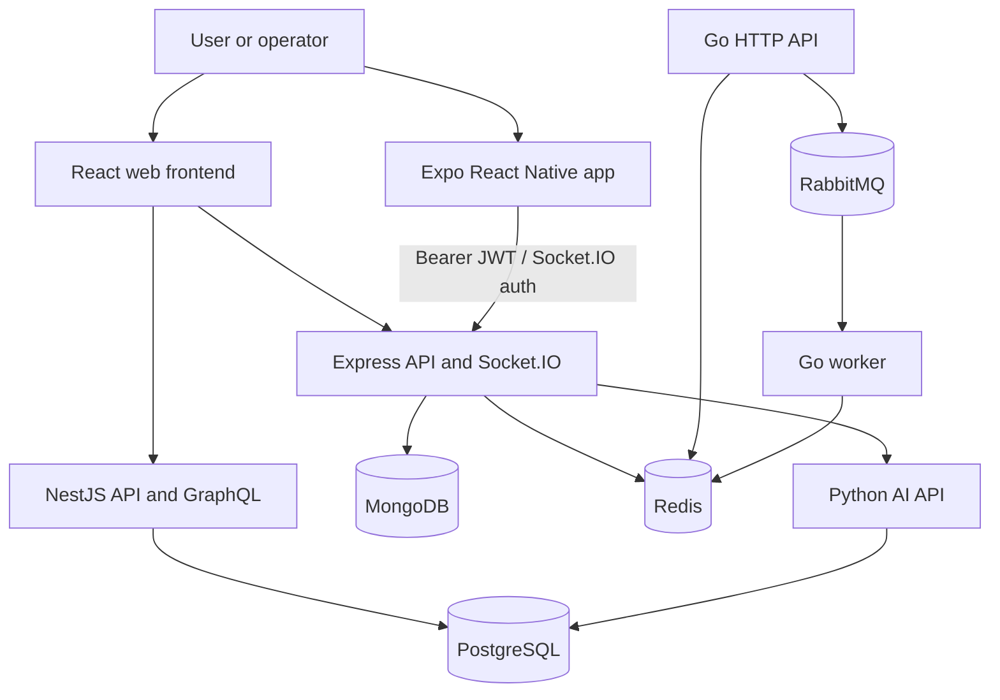

# Relay

**A polyglot real-time messaging, AI knowledge, and operations platform.**

Relay is a multi-service engineering project that brings together a React application, HTTP and GraphQL APIs, real-time messaging, asynchronous job processing, relational and document data stores, and an AI-assisted retrieval workflow. It is designed to demonstrate service boundaries, integration patterns, operational workflows, and the engineering practices required to develop and verify a complex application.

> **Project status:** Active development. This repository is not, by itself, evidence of production readiness. Implementation, automated test coverage, deployment validation, security review, and operational acceptance are separate requirements. Consult [Implementation Status](./docs/implementation-status.md) before making readiness claims.

## Contents

- [Product and capabilities](#product-and-capabilities)
- [Architecture at a glance](#architecture-at-a-glance)
- [Technology and service map](#technology-and-service-map)
- [Prerequisites](#prerequisites)
- [Local development](#local-development)
- [Validation and tests](#validation-and-tests)
- [Configuration and secrets](#configuration-and-secrets)
- [Security principles](#security-principles)
- [Deployment and production readiness](#deployment-and-production-readiness)
- [Engineering documentation](#engineering-documentation)
- [Contribution workflow](#contribution-workflow)
- [Current limitations](#current-limitations)

## Product and capabilities

Relay brings several engineering domains into one repository:

- **Web application:** React/Vite interfaces, authentication, real-time messaging, operational pages, and AI-assisted experiences.
- **Mobile application:** Expo + React Native companion for account access, contact/presence browsing, text messaging, and AI answers with citations; it reuses the Express API rather than duplicating domain logic.
- **API services:** An Express application for HTTP endpoints and Socket.IO integration, alongside a NestJS service exposing GraphQL and other application endpoints.
- **Asynchronous processing:** Go HTTP and worker services, RabbitMQ messaging, Redis-backed state, job status, and reliability mechanisms.
- **Data services:** MongoDB for document-oriented application data, PostgreSQL for relational and AI-related data, and Redis for selected ephemeral or coordination workloads.
- **AI and retrieval:** A Python API with retrieval-augmented generation components for document ingestion, chunking, embeddings, retrieval, and answer generation.
- **Operational delivery:** Docker Compose configuration, Kubernetes base resources and overlays, automated tests, health checks, and deployment documentation.

These are repository-level areas of implementation, not a guarantee that every workflow is fully integrated, hardened, or production-validated. Verify individual capabilities against source code, configuration, and current test results.

## Architecture at a glance

The following is a **logical service map**, not a complete runtime dependency graph. Actual routes, network access, persistence ownership, authentication, and service-to-service contracts must be verified in the implementation and deployment configuration.



### Design boundaries

- **Frontend:** Presentation, client-side interaction, and API consumption. It is not a security boundary; authorization must be enforced by trusted services.
- **Express:** HTTP routes, authentication-related middleware, messaging integration, and Socket.IO functionality.
- **NestJS:** A separately structured service with GraphQL conversation operations, job endpoints, and shared application infrastructure.
- **Go API and worker:** HTTP-facing job operations and asynchronous processing, with queue and status-store integration.
- **Python AI service:** AI and retrieval workflows, including document processing and incident-related operations. Internal endpoints must not be treated as public APIs without an explicit security review.
- **Data and messaging infrastructure:** MongoDB, PostgreSQL, Redis, and RabbitMQ provide different storage and coordination capabilities. Their presence does not automatically establish high availability, durability guarantees, or disaster recovery.

See [Architecture](./docs/architecture.md) for service responsibilities and design details.

## Technology and service map

| Component | Primary role | Local development port |
|---|---|---:|
| React + Vite | Web client | 5173 |
| Expo + React Native | iOS / Android mobile client | Expo-managed |
| Express + Socket.IO | HTTP API and real-time messaging | 5001 |
| NestJS | GraphQL and application API | 3000 |
| Go API gateway | Selected HTTP reverse-proxy routes and health/readiness endpoints | 8090 |
| Go jobs API | Gin-based HTTP and job endpoints | 8081 |
| Go worker | Asynchronous job processing | No public HTTP port assumed |
| Python AI API | AI, document, and retrieval workflows | 8000 |
| MongoDB | Document database | 27017 |
| PostgreSQL | Relational database and AI-related persistence | 5433 |
| Redis | Cache and selected state or coordination workloads | 6379 |
| RabbitMQ | Message broker | 5672; management UI 15672 |

Ports are documented development defaults and may differ by Compose configuration, environment variables, or deployment overlays. The Go jobs API is an HTTP service; do not describe it as gRPC unless a verified implementation is added. The gateway has its own port and only routes explicitly registered in its route table; configured upstream URLs do not mean every upstream path is exposed.

## Prerequisites

Install and verify the versions supported by the repository and its lockfiles:

- Git.
- Node.js and npm.
- Go.
- Python and the project Python dependencies.
- Docker Engine or Docker Desktop with Docker Compose.
- `kubectl` and Kustomize only when validating Kubernetes manifests.

The exact language and runtime requirements can differ between services. Check the relevant package manifests, Go module files, Python dependency files, and CI configuration rather than assuming a single version applies everywhere.

## Local development

### 1. Get the repository and install dependencies

```bash
git clone https://github.com/CLOUDVGR2/Relay.git
cd Relay
npm run install:all
```

If the repository is already cloned, start from its root directory instead. Review the installation scripts before using them in a restricted or automated environment.

### 2. Configure environment variables

```bash
cp .env.example .env
```

Review `.env.example` and each service configuration before starting the application. Populate only the values required for your local setup. Never commit real credentials, tokens, private keys, production connection strings, or populated secret files.

### 3. Start shared infrastructure

**Local stack:** Compose uses official, versioned MongoDB, RabbitMQ, Redis, and PostgreSQL images. It creates managed persistent volumes named `relay-monorepo_mongodb_data`, `relay-monorepo_rabbitmq_data`, `relay-monorepo_redis_data`, and `relay-monorepo_atlas_postgres_data` on first startup. Application images use the `relay-monorepo-*:local` naming scheme. Back up persistent data before intentionally removing or recreating volumes.

```bash
docker compose -f compose.yaml up -d mongodb redis postgres rabbitmq
```

Check container health and logs before launching dependent services:

```bash
docker compose -f compose.yaml ps
docker compose -f compose.yaml logs --tail=100
```

A running container is not proof that an application can authenticate, query its dependencies, or serve valid requests.

### 4. Start application services

Open a separate terminal for each service and run commands from the repository root unless noted.

```bash
npm run dev:express-api
```

```bash
npm run dev:nest-api
```

```bash
npm run dev:web
```

Run the mobile client in another terminal after configuring `apps/mobile/.env` (see [Mobile](./apps/mobile/README.md)):

```bash
npm run dev:mobile
```

Run the Go API:

```bash
cd services/jobs-api && go run .
```

Run the Go worker in another terminal:

```bash
cd services/jobs-worker && go run .
```

Run the Python AI API using the Python environment configured for that service:

```bash
cd services/ai-service && source .venv/bin/activate && uvicorn app.main:app --reload
```

The Python command assumes `services/ai-service/.venv` has already been created and populated with the required dependencies. If it does not exist, follow the Python service dependency and migration documentation first.

### Alternative: start the Compose application

```bash
docker compose -f compose.yaml up -d
```

Inspect the Compose file to understand which services are included, which profiles are enabled, and which configuration values are required. Do not assume this command starts every development-only component or establishes a production deployment.

### Stop the local stack

```bash
docker compose -f compose.yaml down
```

This stops and removes Compose-managed containers and networks. Persistent data may remain in named volumes. Do not use volume-deletion flags unless you intentionally want to remove local persisted data.

## Validation and tests

Run checks from the repository root. Review each command and its service-specific test configuration before interpreting its result.

| Command | Purpose |
|---|---|
| `npm run test:express-api` | Express backend integration tests |
| `npm run test:nest-api` | NestJS tests |
| `npm run test:web` | Web frontend test suite |
| `npm run typecheck:mobile` | Mobile TypeScript check (after installing Expo dependencies) |
| `npm run test:ai-service` | Python AI service tests |
| `npm run test:jobs-api` | Go API tests |
| `npm run test:jobs-worker` | Go worker tests |
| `npm run test:api-gateway` | Go API gateway tests |
| `npm run test:all` | Aggregate configured service test scripts |
| `npm run test:e2e:nest-api` | NestJS end-to-end tests |
| `npm run test:e2e:web` | Frontend end-to-end tests |

The aggregate `test:all` script does not, by itself, mean that every end-to-end test, standalone integration test, browser workflow, security check, or deployment verification has run. Confirm the actual scripts in `package.json` and the service package manifests.

For Go services, run checks from the appropriate module directory when needed:

```bash
cd services/jobs-api && go test ./...
```

```bash
cd services/jobs-worker && go test ./...
```

For Kubernetes manifest rendering:

```bash
kubectl kustomize infrastructure/kubernetes/overlays/local > /dev/null
kubectl kustomize infrastructure/kubernetes/overlays/aws > /dev/null
```

Rendering verifies Kustomize composition only. It does not prove that images exist, secrets are valid, workloads schedule, services become healthy, policies are secure, or a cluster deployment succeeds.

**Verification standard:** Record the command, environment, commit SHA, exit status, and relevant output for release evidence. A test result from an earlier commit is historical evidence, not proof of the current tree.

## Configuration and secrets

- Use `.env.example` to understand expected local configuration.
- Validate required variables at service startup where supported.
- Keep development, test, staging, and production credentials separate.
- Use a secret manager or deployment-platform secret facility for deployed environments.
- Rotate credentials that may have been exposed; deleting a secret from the latest commit does not remove it from Git history or external logs.
- Do not place credentials in frontend variables: browser-delivered configuration is public.
- Treat internal service URLs, callback URLs, CORS origins, upload limits, database URLs, queue credentials, AI provider settings, and authentication configuration as security-sensitive deployment inputs.
- Review migrations and persistence settings before running them against valuable data.

## Security principles

The project should be assessed against the following baseline:

1. **Identity and authorization:** Enforce authorization on the server for every protected operation. Test tenant and resource ownership boundaries, not only successful login.
2. **Input handling:** Validate request bodies, query parameters, uploaded files, and cross-service messages. Apply size limits and safe parsing.
3. **Network trust:** Restrict internal APIs, trusted origins, management interfaces, and database access to intended callers.
4. **Secrets:** Avoid source-control credentials and logs containing tokens, session identifiers, private data, or sensitive prompts.
5. **Data isolation:** Apply tenant-scoped database operations and test negative cross-tenant access cases.
6. **AI safety:** Treat retrieved documents and user prompts as untrusted input. Restrict tool permissions, validate proposed actions, and require explicit authorization for consequential operations.
7. **Dependency and image hygiene:** Review dependency updates, container base images, provenance, vulnerability findings, and build reproducibility.
8. **Operational controls:** Define least-privilege access, auditability, incident response, backup protection, and recovery procedures.

This list is an engineering baseline, not a statement that every control has already been implemented or independently audited. See [Security and Operations](./docs/security-and-operations.md).

## Deployment and production readiness

The repository contains Kubernetes base resources and local and AWS overlays. The AWS overlay and related documents are deployment materials, **not evidence of an existing AWS environment**. Do not infer that EKS, ECR, load balancers, DNS, TLS certificates, managed databases, or production monitoring have been provisioned.

Before a real deployment, verify at minimum:

- Approved target architecture, service ownership, network boundaries, and cost.
- Immutable image tags, image provenance, and reproducible build outputs.
- Validated configuration and secret delivery without committed credentials.
- Health and readiness behavior, resource requests and limits, autoscaling assumptions, and graceful shutdown.
- Persistent storage, database migrations, backup schedules, and tested restoration.
- Authentication, authorization, tenant isolation, ingress rules, TLS, and least privilege.
- Logs, metrics, traces where implemented, actionable alerts, and on-call ownership.
- Load behavior, dependency failures, queue recovery, duplicate delivery, and idempotency.
- A documented rollout, rollback, incident escalation, and release acceptance decision.

Use [Production Guide](./docs/production-guide.md), [AWS deployment architecture](./docs/architecture/aws-deployment.md), and the [AWS deployment checklist](./docs/aws-deployment-checklist.md) for detailed planning. No cloud resources should be created merely by reading or validating these documents.

## Engineering documentation

### Core engineering references

- [Implementation Status](./docs/implementation-status.md) — verified milestones, test-result caveats, outstanding work, and production-readiness gates.
- [Production Guide](./docs/production-guide.md) — deployment guidance, operations, security, monitoring, backup, recovery, and release acceptance.
- [Architecture](./docs/architecture.md) — service boundaries, request flows, data responsibilities, and system design.
- [Mobile architecture and security](./docs/mobile-architecture.md) — native client boundaries, bearer authentication, secure storage, realtime behavior, and mobile release gates.
- [Mobile app guide](./apps/mobile/README.md) — Expo setup, API configuration, implemented workflows, and known limitations.
- [Engineering Standards](./docs/engineering-standards.md) — coding, testing, security, reliability, and definition-of-done expectations.
- [Code Commenting Standard](./docs/code-commenting-standard.md) — intent-focused comments and language conventions.
- [Architecture Decision Records](./docs/decisions/README.md) — durable decisions, alternatives, trade-offs, and verification requirements.
- [Pull Request Template](./.github/pull_request_template.md) — scope, risk, validation evidence, and reviewer checklist.
- [Docker Compose](./compose.yaml) — local multi-service configuration.

### AI and knowledge workflows

- [AI API Reference](./docs/ai-api-reference.md) — available AI-related endpoints and their usage.
- [AI User Guide](./docs/ai-user-guide.md) — user-facing workflow guidance and limitations.
- [Knowledge Base](./docs/ai-knowledge-base.md) — retrieval architecture, ingestion, and knowledge workflow details.
- [RAG Troubleshooting](./docs/ai-rag-troubleshooting.md) — common service, ingestion, retrieval, and answer-generation issues.
- [Security and Operations](./docs/security-and-operations.md) — operational security and verification guidance.

### Deployment references

- [AWS deployment architecture](./docs/architecture/aws-deployment.md) — proposed AWS design and deployment assumptions.
- [AWS deployment checklist](./docs/aws-deployment-checklist.md) — preflight review and release safeguards.
- [Kubernetes AWS overlay README](./infrastructure/kubernetes/overlays/aws/README.md) — overlay inputs and manifest validation.

### Service-specific references

- [Frontend README](./apps/web/README.md) — frontend development and testing.
- [NestJS README](./services/nest-api/README.md) — NestJS service development and interfaces.
- [Python migration notes](./services/ai-service/migrations/README) — database migration guidance.

## Contribution workflow

1. Identify the owning service and read its existing conventions.
2. Trace the request path across the frontend, API, worker, and persistence layers where applicable.
3. Define the expected behavior, authorization rules, failure modes, and compatibility implications before implementation.
4. Add or update unit, integration, contract, and end-to-end tests appropriate to the change.
5. Update API references, configuration examples, architecture notes, and operational instructions when behavior changes.
6. Run the relevant checks and record failures honestly. Do not describe skipped or unexecuted tests as passing.
7. Review the complete diff for unintended changes, credentials, generated files, and temporary artifacts.
8. Keep commits focused, reproducible, and reviewable.

A change is not complete merely because it compiles. It should be testable, secure for its intended context, observable enough to diagnose, documented, and recoverable when it affects persistent data or deployed workloads.

## Current limitations

- Relay is an actively developed multi-service application; feature presence does not establish end-to-end correctness.
- Historical test counts and previous green runs must be revalidated against the current commit.
- Compose startup and successful Kubernetes rendering do not establish production availability or security.
- AWS deployment materials describe a proposed path; they do not establish that cloud infrastructure exists.
- Production claims require current evidence for security controls, load behavior, backup restoration, monitoring, failure recovery, and rollback.
- Architecture descriptions should be updated whenever source code or runtime wiring changes. If documentation and implementation disagree, verify the implementation and correct the documentation.

## License

Check the repository for an explicit license before treating this project as open source or reusing its code. No license grant should be inferred from public repository visibility alone.
