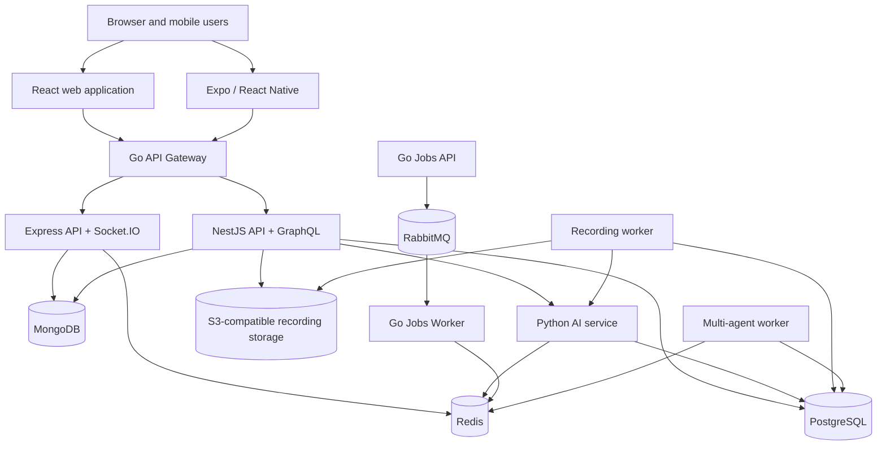

# Relay

**A real-time collaboration, AI knowledge, and operational intelligence platform.**

Relay is a polyglot application platform that combines browser and native mobile experiences with real-time communication, GraphQL and REST APIs, asynchronous execution, AI-assisted knowledge workflows, and Kubernetes-oriented infrastructure. The repository is structured as a pnpm monorepo with independently packaged services written in TypeScript/JavaScript, Go, and Python.

The platform brings together product engineering and distributed-systems concerns in one coherent system: identity propagation, resource-level authorization, API composition, durable job processing, tenant-scoped retrieval, media workflows, operational telemetry, and repeatable delivery.

## Product surface

| Domain | Capabilities represented in the implementation |
|---|---|
| Collaboration | Account access, user discovery, conversations, message history, real-time messaging, notifications, and activity views |
| Native experience | Expo / React Native application for Android and iOS, authenticated API access, Socket.IO connectivity, call workflows, and local recording support |
| Calls and media | Call lifecycle operations, media-session authorization, consent-aware recording upload, recording storage integration, and downstream processing |
| Work management | Task creation and management, checklist items, task links, job submission, and job status |
| AI assistance | Conversation analysis, incident intelligence, document ingestion, semantic retrieval, grounded answers, and multi-agent task execution |
| Operations | Operational dashboards, incident workflows, service health, metrics, and deployment-oriented infrastructure |
| Platform engineering | Docker Compose, Kubernetes Kustomize bases and overlays, Terraform modules, CI workflows, automated tests, and security scanning configuration |

The table describes repository-backed product domains. Individual API contracts and deployment topology are documented in the relevant service references.

## Architecture



The Go gateway exposes a deliberately narrow public route allowlist. Express owns `/api` and Socket.IO traffic; NestJS owns `/graphql`, `/calls`, `/jobs`, `/docs`, and `/health` paths. The Go Jobs API and Python internal APIs are not exposed as general public gateway routes. See [System Architecture](docs/architecture.md) and [API Contracts](docs/ai-api-reference.md).

## Technology portfolio

| Layer | Technologies | Repository location |
|---|---|---|
| Web | React 19, Vite, React Router, Zustand, Tailwind CSS, Vitest, Playwright | `apps/web/` |
| Mobile | Expo SDK 57, React Native 0.86, TypeScript, React Navigation, WebRTC, SecureStore, SQLite | `apps/mobile/` |
| API gateway | Go HTTP server, reverse proxy, Prometheus instrumentation | `services/api-gateway/` |
| Collaboration API | Node.js, Express, Socket.IO, Mongoose, Redis | `services/express-api/` |
| Domain API | NestJS, TypeScript, GraphQL, REST, Prisma, Mongoose, PostgreSQL | `services/nest-api/` |
| Jobs API and worker | Go, Gin, RabbitMQ AMQP, Redis | `services/jobs-api/`, `services/jobs-worker/` |
| AI services | Python, FastAPI, SQLAlchemy async, Alembic, pgvector, LangGraph, LiteLLM, MCP | `services/ai-service/` |
| Persistence and messaging | MongoDB, PostgreSQL / pgvector, Redis, RabbitMQ, S3-compatible object storage | Compose and Kubernetes manifests |
| Delivery | Docker, Docker Compose, Kubernetes, Kustomize, Terraform, GitHub Actions, Jenkins | `infrastructure/`, `.github/` |

## Repository map

```text
apps/
  web/                         React browser application
  mobile/                      Expo / React Native application
services/
  api-gateway/                 Go public HTTP gateway
  express-api/                 Express and Socket.IO collaboration API
  nest-api/                    NestJS REST and GraphQL domain API
  jobs-api/                    Go asynchronous job submission/status API
  jobs-worker/                 Go RabbitMQ consumer
  ai-service/                  Python AI, retrieval, incident, and worker modules
infrastructure/
  aws/terraform/               AWS resource and IAM definitions
  kubernetes/                  Kustomize base, local overlay, AWS overlay
  devops/                      Jenkins and container build assets
monitoring/                    Prometheus, Blackbox Exporter, Grafana provisioning
tests/                         Cross-service integration, E2E, and performance contracts
docs/                          Architecture, API, security, operations, and service references
```

## Local development

### Prerequisites

- Node.js compatible with the workspace manifests and pnpm 12.
- Go versions declared by each Go module.
- Python 3.11+ compatible with the service dependencies.
- Docker Engine with Docker Compose.
- Android Studio / Xcode and the Expo development tooling for native builds.
- `kubectl` and Kustomize for Kubernetes validation.

### Install workspace dependencies

```bash
corepack pnpm install
```

### Configure environment

```bash
cp .env.example .env
```

Populate the required local-only values described by `compose.yaml`, each service `.env.example`, and the configuration reference. The Compose stack additionally requires recording-storage, internal service, and observability credentials that are intentionally generated locally. Never commit populated `.env` files.

For the mobile application, configure `apps/mobile/.env` with a device-reachable API origin:

```dotenv
EXPO_PUBLIC_API_URL=http://<host-reachable-address>:8090/api
```

On a physical device, `localhost` refers to the device itself. The address must resolve from the phone and the gateway must be exposed on the host network.

### Run the containerized platform

```bash
docker compose up -d --build
docker compose ps
```

The Compose file defines the application services, data stores, broker, object storage, and observability components. Inspect `compose.yaml` for port bindings, required variables, volume semantics, and service dependencies before using the stack.

### Run selected development processes

```bash
pnpm dev:web
pnpm dev:express-api
pnpm dev:nest-api
pnpm dev:mobile
```

Run Go services from their module directories:

```bash
cd services/api-gateway && go run .
cd services/jobs-api && go run .
cd services/jobs-worker && go run .
```

Run the Python service after creating its virtual environment and installing `requirements.txt`:

```bash
cd services/ai-service
uvicorn app.main:app --reload
```

For a complete local topology, prefer Compose so service DNS names and dependency endpoints match the checked-in configuration.

## Verification

The root workspace exposes these aggregate commands:

```bash
pnpm test:all
pnpm build:all
pnpm typecheck:mobile
pnpm test:e2e:web
pnpm test:e2e:nest-api
```

The aggregate scripts execute the commands currently declared in `package.json`; they do not imply that every browser journey, device build, infrastructure deployment, or production recovery exercise is included. Each service reference lists its focused checks. Capture the tested commit, command, environment, and exit status when publishing validation evidence.

## Documentation

- [Engineering portfolio case study](docs/engineering-portfolio.md)
- [Product and experience architecture](docs/product-experience.md)
- [Platform overview](relay-platform-overview.md)
- [System architecture](docs/architecture.md)
- [Platform capabilities](docs/platform-capabilities.md)
- [Repository structure](docs/repository-layout.md)
- [Engineering standards](docs/engineering-standards.md)
- [Security architecture](docs/security/threat-model.md)
- [AI and retrieval architecture](docs/ai-knowledge-base.md)
- [Mobile architecture](docs/mobile-architecture.md)
- [Release and operations](docs/production-guide.md)
- [Kubernetes deployment](docs/architecture/aws-deployment.md)
- [Service documentation index](docs/README.md)

## Engineering principles

Relay is organized around explicit service ownership, authenticated service boundaries, tenant-aware data access, bounded asynchronous execution, observable interfaces, and declarative infrastructure. The client applications are presentation and interaction layers; authorization and data integrity remain server responsibilities. Service-specific contracts remain authoritative in their implementation and API schemas.
