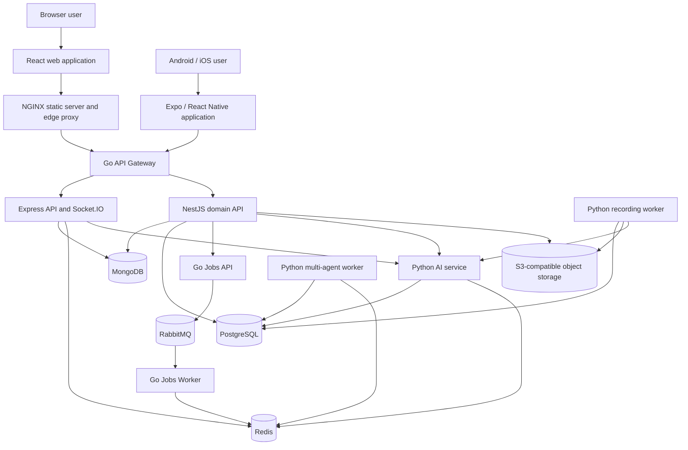

# Relay — Enterprise Collaborative Operations Software Engineering Platform

**Relay** is a multi-client, multi-service software platform that brings together team collaboration, real-time communication, work coordination, AI-assisted knowledge workflows, and operational tooling. It is engineered as a distributed, polyglot monorepo spanning frontend applications, mobile experiences, backend services, API infrastructure, data systems, AI capabilities, cloud infrastructure, and operational engineering.

Relay is intended to be understood and evaluated as an integrated engineering system—not simply as a web application, mobile app, or collection of backend services. Its architecture demonstrates the intersection of product engineering, distributed systems, platform engineering, artificial intelligence, infrastructure automation, application security, and production reliability.

The platform encompasses the following engineering disciplines:

### 1. Frontend Engineering, Product Experience and UX/UI Engineering

Design and development of user-facing applications across web and mobile environments, including:

- React-based web application engineering and component architecture.
- React Native and Expo mobile application development.
- User experience architecture, interaction design, and interface engineering.
- Responsive layouts, reusable components, design consistency, and accessibility considerations.
- Client-side application state, navigation, API integration, and authenticated experiences.
- Cross-platform behavioral consistency and end-to-end user workflows.
- Performance-conscious frontend architecture and production asset delivery.

### 2. Backend Engineering, API Architecture and Systems Integration

Development of service-oriented backend capabilities and integration contracts, including:

- TypeScript, Node.js, Express, and NestJS backend engineering.
- Go-based gateway and backend service development.
- Python-based AI service integration.
- REST API architecture, endpoint design, request validation, and response contracts.
- Authentication, authorization, identity propagation, and service boundaries.
- Inter-service communication, middleware, error handling, and lifecycle management.
- Integration of application services with databases, messaging infrastructure, AI systems, and external dependencies.

### 3. Distributed Systems and Platform Architecture

Engineering of a multi-service environment in which independent components collaborate through defined interfaces and infrastructure, including:

- Polyglot microservice and modular service architecture.
- Service discovery, routing, and internal communication.
- Real-time communication and event-driven workflows.
- Asynchronous processing, background jobs, and worker services.
- Message-oriented integration using infrastructure such as RabbitMQ.
- Redis-backed coordination and supporting application capabilities.
- Distributed execution, fault isolation, service health, and dependency management.
- Cross-service identity, data ownership, and consistency boundaries.

### 4. Database Engineering and Data Architecture

Design and integration of persistent data systems supporting application, operational, and AI workloads, including:

- PostgreSQL relational data architecture and schema management.
- MongoDB document-oriented persistence.
- Redis-backed caching and coordination.
- SQLAlchemy and Prisma-based data access patterns.
- Database migrations, schema evolution, relational integrity, and indexing.
- Tenant-aware data organization, ownership boundaries, and access isolation.
- Data lifecycle management, backup considerations, and recovery planning.
- PostgreSQL vector storage and retrieval infrastructure for knowledge workflows.

### 5. AI Engineering, Generative AI and Knowledge Systems

Integration of artificial intelligence into application and operational workflows, including:

- Python and FastAPI AI service architecture.
- Retrieval-Augmented Generation (RAG) and document knowledge workflows.
- Document ingestion, content processing, chunking, and embedding generation.
- Vector similarity search, PostgreSQL full-text search, and hybrid retrieval.
- Evidence-grounded answer generation and source attribution.
- Local model integration through Ollama and compatible inference interfaces.
- AI orchestration, multi-agent workflows, and task execution.
- Structured model responses, citation validation, abstention behavior, and answer-quality safeguards.
- AI service observability, error handling, and integration with application identity and authorization boundaries.

### 6. Infrastructure Engineering, DevOps and DevSecOps

Engineering the environments and delivery systems required to build, configure, deploy, and maintain the platform, including:

- Docker and Docker Compose-based multi-service environments.
- Container build and runtime optimization.
- Kubernetes infrastructure and deployment configuration.
- Infrastructure automation and Terraform-based provisioning assets.
- CI/CD workflows and automated quality gates.
- Dependency and lockfile integrity, build reproducibility, and release validation.
- Secure configuration, secrets management, and environment isolation.
- Static analysis, security scanning, dependency controls, and secure development practices.
- Deployment orchestration, release management, rollback planning, and operational readiness.

### 7. Cloud Engineering and Infrastructure Architecture

Design and implementation of cloud-oriented infrastructure and deployment capabilities, including:

- AWS-oriented deployment architecture and infrastructure documentation.
- Cloud networking and service connectivity considerations.
- Container orchestration and Kubernetes deployment patterns.
- Object and artifact storage integration.
- External secrets and configuration management.
- Infrastructure provisioning, environment separation, and deployment automation.
- Cloud resource management, resilience, security boundaries, and operational cost considerations.

### 8. Observability Engineering, SRE and Production Operations

Engineering operational visibility and reliability practices across the distributed platform, including:

- Centralized application and service logging.
- Metrics instrumentation and Prometheus-oriented observability.
- Health checks, readiness checks, and service dependency monitoring.
- Distributed troubleshooting and cross-service failure analysis.
- Performance evaluation, resource efficiency, and capacity considerations.
- Incident response, operational runbooks, and recovery procedures.
- Service Level Objectives (SLOs), Service Level Indicators (SLIs), and error-budget frameworks.
- Reliability engineering, failure isolation, graceful degradation, and deployment safety.
- Backup, disaster recovery, and production-readiness planning.

### 9. Software Quality, Testing and Engineering Governance

Engineering practices that support maintainability, controlled change, and technical accountability, including:

- Unit, integration, API, and end-to-end testing.
- Automated validation across application and service boundaries.
- Type checking, linting, and code-quality enforcement.
- Contract validation and service integration testing.
- Architecture Decision Records (ADRs) and documented technical decisions.
- Engineering standards, contribution guidelines, and repository governance.
- Security review, technical due diligence, and production acceptance criteria.

## An Integrated Engineering System

These disciplines are connected through the platform's architecture and delivery lifecycle. Frontend and mobile applications consume authenticated backend APIs; backend services coordinate persistent data, real-time communication, asynchronous processing, and AI capabilities; infrastructure and cloud deployment assets provide the runtime foundation; and observability, security, testing, and reliability practices support the engineering lifecycle.

The repository is organized as a polyglot monorepo containing React and Expo clients, TypeScript/Node.js APIs, a Go API gateway and job services, a Python AI service, PostgreSQL and MongoDB persistence, Redis coordination, RabbitMQ messaging infrastructure, and deployment, security, testing, and observability assets.

**Relay represents a broad, multidisciplinary software engineering effort across product development, full-stack engineering, backend architecture, distributed systems, database engineering, AI engineering, cloud infrastructure, DevOps, DevSecOps, and Site Reliability Engineering.**

This repository is intended to serve as an engineering reference, architecture portfolio, implementation record, and technical evaluation resource for enterprise engineering leaders, principal and staff engineers, platform architects, hiring managers, technical interviewers, and technical recruiters. Service boundaries, public and internal API contracts, data ownership, security assumptions, operational requirements, and deployment artifacts are documented throughout the repository and its enterprise technical dossier.

The implementation should be evaluated against the capabilities demonstrated in source code, automated tests, configuration, and deployment artifacts. Production maturity, independent security assurance, operational SLO attainment, and live deployment status should be assessed separately rather than inferred from architectural documentation alone.

## Executive overview

Relay combines synchronous, user-facing workflows with asynchronous execution:

- **Collaboration:** identity and session flows, user discovery, conversations, message history, read state, notifications, and realtime delivery.
- **Calls and media:** call lifecycle operations, participant and recording-consent handling, media-session authorization, upload lifecycle, object storage, and asynchronous recording processing.
- **Work coordination:** tasks, checklists, task links, job submission, job history, and worker processing.
- **AI and knowledge:** transcript analysis, incident intelligence, document ingestion, vector and keyword retrieval, evidence-grounded answers, and persisted multi-agent tasks.
- **Platform operations:** health/readiness endpoints, metrics, containerized local composition, Kubernetes overlays, AWS Terraform, CI workflows, and operator documentation.

The platform deliberately keeps client presentation, domain APIs, internal AI execution, and asynchronous workers in separate runtime boundaries. Those boundaries are important to understanding the system and evaluating its engineering trade-offs.

## System context



The Gateway's current public allowlist forwards `/api` and `/socket.io` to Express, and `/jobs`, `/graphql`, `/calls`, `/docs`, and `/health` to NestJS. It owns `/healthz`, `/readyz`, `/gateway/docs`, and `/gateway/openapi.json`. The configured Go Jobs API and Python AI service are not directly exposed by the Gateway route table. The NestJS jobs facade integrates with the Go Jobs API; the Express and NestJS services call the Python AI service over internal service URLs and bearer credentials.

## Service ownership at a glance

| Component | Primary responsibility | Main contract | Principal state/dependencies |
|---|---|---|---|
| `apps/web` | Browser experience and operational workspace | HTTP, GraphQL, Socket.IO via NGINX/Gateway | Browser-managed UI state; server-owned business state |
| `apps/mobile` | Native Android/iOS experience | Bearer-authenticated HTTP, GraphQL, Socket.IO | Secure token storage, local message cache, recording recovery |
| `services/api-gateway` | Public application routing and reverse proxy | HTTP and WebSocket forwarding | Route configuration, request IDs, gateway metrics |
| `services/express-api` | Identity, collaboration, notifications, AI facade, realtime events | REST and Socket.IO | MongoDB, Redis, internal Nest/Python integrations |
| `services/nest-api` | Conversation, task, call, job-facade, recording, AI domain operations | GraphQL and REST | PostgreSQL/Prisma, MongoDB/Mongoose, Redis, object storage, internal services |
| `services/jobs-api` | Job submission, history/status, worker health | HTTP; internal job operations use bearer authentication | RabbitMQ, Redis |
| `services/jobs-worker` | Consume and process supported asynchronous jobs | RabbitMQ messages | RabbitMQ, Redis coordination/status |
| `services/ai-service` | RAG, conversation analysis, incident intelligence, multi-agent task API | FastAPI HTTP | PostgreSQL/pgvector, Redis, model providers |
| `multi-agent-worker` | Claim and execute persisted multi-agent tasks | Python process and Redis/PostgreSQL coordination | PostgreSQL, Redis, configured provider adapters |
| `recording-worker` | Retrieve recordings and run transcription/analysis processing | Python worker process | PostgreSQL, S3-compatible storage, model assets, AI API |

See [the Enterprise Technical Dossier](docs/enterprise-technical-dossier.md) for the full system model, request paths, trust boundaries, evidence matrix, operational considerations, and review guide.

## Technology portfolio

| Layer | Implementation visible in this repository |
|---|---|
| Browser | React 19, Vite, React Router, Zustand, Tailwind CSS, DaisyUI, Vitest, Playwright |
| Native | Expo SDK 57, React Native 0.86, TypeScript, React Navigation, WebRTC-related call integration, SecureStore/SQLite dependencies |
| API gateway | Go `net/http`, reverse proxy, request metadata, Prometheus instrumentation |
| Collaboration API | Node.js 22, Express 4, Socket.IO, Mongoose, Redis |
| Domain API | NestJS 12, TypeScript, GraphQL/Apollo, REST, Prisma, Mongoose, Redis |
| Job services | Go, Gin, RabbitMQ AMQP, Redis |
| AI service | Python 3.14 runtime image, FastAPI, SQLAlchemy async, Alembic, pgvector, LiteLLM, Ollama-compatible generation, LangGraph, MCP |
| Persistence and messaging | MongoDB 8, PostgreSQL 17 with pgvector, Redis 7, RabbitMQ 4, RustFS S3-compatible object storage |
| Delivery and operations | Docker, Docker Compose, Kubernetes/Kustomize, Terraform, GitHub Actions, Jenkinsfile, Prometheus, Grafana, Blackbox Exporter, cAdvisor |

Versions above describe the supplied manifests and image definitions, not a claim that every production environment runs the same versions. The lockfiles and build manifests are authoritative.

## Repository map

```text
apps/
  web/                         React browser application
  mobile/                      Expo / React Native application
services/
  api-gateway/                 Go HTTP reverse proxy and public route policy
  express-api/                 Express REST and Socket.IO collaboration API
  nest-api/                    NestJS GraphQL and REST domain API
  jobs-api/                    Go job submission and status API
  jobs-worker/                 Go RabbitMQ consumer
  ai-service/                  Python AI, RAG, incident, multi-agent, recording code
infrastructure/
  aws/terraform/               AWS infrastructure and IAM definitions
  kubernetes/                  Kustomize base, local overlay, AWS overlay
  devops/                      Jenkins and container build assets
monitoring/                    Prometheus, Blackbox Exporter, Grafana configuration
 tests/                        Integration, E2E, and performance test contracts
 docs/                         Architecture, service, security, operations, and portfolio docs
```

## Local development quick start

### Prerequisites

- Node.js compatible with the workspace and pnpm 12.15.0.
- Go versions supported by the modules under `services/*`.
- Python compatible with `services/ai-service/requirements.txt` (the API container currently uses Python 3.14; the recording-worker Dockerfile uses Python 3.12).
- Docker Engine and Docker Compose.
- Expo device/simulator tooling for native-device verification.
- `kubectl`, Kustomize, and Terraform only when validating infrastructure assets.

### Install and configure

```bash
corepack pnpm install
cp .env.example .env
```

Populate local-only values required by `compose.yaml` and the relevant service `.env.example` files. Do not commit populated environment files. The mobile app requires a device-reachable URL, for example:

```dotenv
EXPO_PUBLIC_API_URL=http://<host-reachable-address>:8090/api
```

A physical phone cannot use its own `localhost` to reach the development host. `EXPO_PUBLIC_*` values are embedded in the client bundle and must never contain server secrets.

### Start the containerized platform

```bash
docker compose up -d --build
docker compose ps
```

The local frontend is published at `http://localhost:8088`, the Go Gateway at `http://localhost:8090`, and Expo Metro at `http://localhost:8081`. Data-service ports and other host bindings are defined in `compose.yaml`; most backend dependencies are bound to loopback for local development.

### Useful workspace commands

```bash
pnpm test:all
pnpm build:all
pnpm typecheck:mobile
pnpm test:e2e:web
pnpm test:e2e:nest-api
```

`test:all` and `build:all` execute the scripts in the root manifest. The AI test script expects `services/ai-service/.venv/bin/python` to exist. Focused service commands and current test boundaries are documented in [Testing Strategy](docs/testing-strategy.md).

## Engineering and evidence principles

Relay is evaluated through explicit ownership, reproducible builds, bounded interfaces, least-privilege service access, data-integrity rules, test evidence, and operational readiness—not through technology-name count. The repository contains implementation and infrastructure assets, but production acceptance requires environment-specific evidence: deployed image digests, database migration status, security review, backups and restore exercises, measured SLOs, capacity tests, monitoring and alert routing, and named operational ownership.

## Documentation map

- [Enterprise Technical Dossier](docs/enterprise-technical-dossier.md) — executive and technical master reference.
- [System Architecture](docs/architecture.md) and [Service Catalog](docs/architecture/service-catalog.md) — boundaries and service responsibilities.
- [API and AI Reference](docs/ai-api-reference.md) — route ownership and internal/public distinctions.
- [Data Architecture](docs/data-architecture.md) — persistence, data ownership, and consistency.
- [Security Threat Model](docs/security/threat-model.md) and [Security Policy](SECURITY.md) — trust boundaries and reporting.
- [Platform Capabilities](docs/platform-capabilities.md) and [Engineering Portfolio](docs/engineering-portfolio.md) — implementation evidence for technical reviewers and hiring teams.
- [Production Guide](docs/production-guide.md), [AWS Deployment](docs/architecture/aws-deployment.md), and [Operations](docs/operations/incident-response.md) — release and runtime practices.
- [Documentation Index](docs/README.md) — complete guide map.
