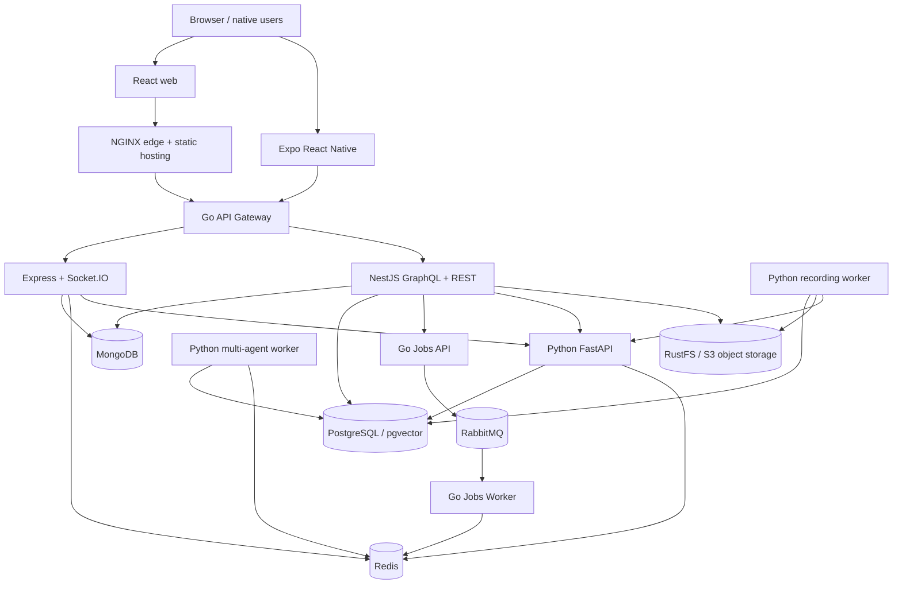

# Relay System Architecture

## 1. Architectural intent

Relay is a polyglot, service-oriented platform with two clients and several independently started backend runtimes. The architecture separates interactive request handling, realtime transport, domain state, asynchronous processing, AI orchestration, media processing, and infrastructure concerns.

The design uses a monorepo for coordinated change review while retaining per-runtime dependency and build boundaries:

- pnpm workspace for `apps/*`, `services/express-api`, and `services/nest-api`;
- independent Go modules for Gateway, Jobs API, and Jobs Worker;
- a dedicated Python package, dependency manifests and Alembic migrations for AI workflows;
- Docker, Compose, Kustomize, Terraform, monitoring, tests, and CI assets in dedicated folders.

A single Git repository is not a single deployment unit. Images, workers, schemas, and runtime configuration are service-specific.

## 2. Context and containers

The diagram shows logical integrations. It does not assert a single production network, availability zone, or deployment count.

## 3. Service responsibility and contract ownership

| Service | Owns | Does not own |
|---|---|---|
| Web | Browser presentation, route composition, interaction state | Server authorization, canonical business data |
| Mobile | Native navigation, local media/recording lifecycle, client API calls | Call authorization, document ACLs, canonical user identity |
| NGINX | Static delivery and configured edge path forwarding | Domain business rules |
| Go Gateway | Public path allowlist, reverse proxy, request IDs, gateway probes/metrics | Downstream auth, GraphQL schema, business validation |
| Express | Auth, collaboration-oriented REST, Socket.IO, notifications, incidents facade, AI facade | Nest relational task/call domain, Python model execution |
| NestJS | Conversation/task/call GraphQL and REST domains, recording, jobs and AI facades | Internal queue worker implementation or AI model execution |
| Go Jobs API | Job contract, submission/status and worker health | Business processing implementation |
| Go Jobs Worker | RabbitMQ consumption, supported job execution, retry/DLQ, idempotency coordination | Public application API |
| Python AI | RAG, conversation analysis, incident intelligence, multi-agent APIs | Browser/mobile session authentication; client UI |
| Python workers | Long-running recording and multi-agent execution | Public ingress |

## 4. Ingress and route policy

### Go Gateway

The Gateway route table in `services/api-gateway/server.go` is authoritative:

| Path | Target | Access interpretation |
|---|---|---|
| `/api`, `/api/` | Express | Browser/native API facade; Express authenticates protected operations |
| `/socket.io/` | Express | Realtime handshake and event authorization |
| `/jobs`, `/jobs/` | NestJS | Nest jobs facade; it may invoke the internal Go Jobs API |
| `/graphql`, `/graphql/` | NestJS | GraphQL endpoint |
| `/calls`, `/calls/` | NestJS | Call and recording REST paths |
| `/docs`, `/docs/` | NestJS | Swagger documentation |
| `/health`, `/health/` | NestJS | Health endpoints |
| `/healthz`, `/readyz` | Gateway | Liveness and dependency readiness |
| `/gateway/docs`, `/gateway/openapi.json` | Gateway | Gateway-owned documentation |

Python AI and Go Jobs internal endpoints are not directly routed by the Gateway allowlist. NGINX contains selected service-specific diagnostic routes; these do not change the Gateway route policy.

### Gateway request controls

The Gateway validates incoming request IDs or creates new ones, propagates them, applies security headers, honors forwarding metadata only from configured trusted proxy CIDRs, uses bounded transport behavior and upstream response-header timeouts, preserves WebSocket hijacking, and records metrics with bounded route labels. Gateway readiness checks Express `/api/health/ready` and Nest `/health/ready`.

## 5. Application boundary design

### Express

The Express application installs Helmet, credentialed CORS allowlisting, body parsing limits, cookie parsing, metrics, health endpoints, Swagger, route modules and an API 404 boundary. It serves the SPA in a production configuration only when that mode is selected; the standalone `frontend` Compose service serves NGINX static assets.

### NestJS

NestJS installs CORS, Helmet, cookie parsing, request context middleware, request timing, Prometheus metrics and a global exception filter. HTTP/GraphQL authentication guards protect domain operations. DTO validation and environment validation define request and runtime boundaries. Prisma is the relational persistence client.

### Python

FastAPI routers are split by domain: health/status, incidents, conversation analysis, documents/RAG and multi-agent tasks. Protected service APIs require the configured internal bearer token. The Relay user identity is provided in a separate header where tenant resolution is required. Health and readiness have different dependency semantics.

### Go services

Gateway uses the standard library HTTP stack and reverse proxy. The Jobs API uses Gin. The Jobs Worker is a process/consumer, not an HTTP server; worker health is surfaced through the Jobs API using heartbeat state.

## 6. Data and persistence boundaries

- **MongoDB:** Express-oriented identity and collaboration records; Nest consumes the existing user identity integration.
- **PostgreSQL:** Nest relational domain data and Python AI data models. The same PostgreSQL service can host schemas/databases used by separate applications, but the services keep independent persistence code and migration tools.
- **pgvector:** vector column for document chunk embeddings; current retrieval expects 768 dimensions.
- **Redis:** selected caches, rate limiting, leases, heartbeats, idempotency and worker progress coordination.
- **RabbitMQ:** Go job transport with delayed retry and dead-letter queues.
- **Object storage:** RustFS in local Compose and S3-compatible integration points in Kubernetes/AWS deployment assets.

Do not assume a distributed transaction across these systems. Model workflows as state machines with explicit retries, idempotency, and reconciliation.

## 7. Tenant and sharing semantics

The AI service maps Relay users to tenant records. Incident and multi-agent records remain tenant-associated. Knowledge document ingest, list and direct document fetch resolve the requesting user's tenant. Current search and answer endpoints invoke retrieval without a tenant filter to support the shared Knowledge Base behavior. This means the retrieval corpus is shared across authenticated Relay identities in the current implementation.

The design preserves uploader identity on retrieved evidence and resolves display names in the Express answer response. Attribution does not restrict access. There is no per-document visibility or organization/group ACL in the current retrieval query. Enterprises handling confidential or customer-segregated content should treat this as a material access-control requirement before onboarding such data.

## 8. Asynchronous execution

| Workflow | Submission/control plane | Execution plane | Coordination |
|---|---|---|---|
| Go jobs | Nest facade / Go Jobs API | Go Jobs Worker | RabbitMQ + Redis |
| Multi-agent | Python multi-agent API | Python multi-agent worker | PostgreSQL task state + Redis lease/progress |
| Recording | Nest call/recording API | Python recording worker | PostgreSQL job/state + object storage + Redis |

Queue messages and worker leases should be treated as at-least-once execution boundaries. Idempotency, fencing, bounded retries, dead-letter policies, and operator replay procedures are critical.

## 9. AI architecture

The AI service includes:

- **RAG ingestion:** validates document input, chunks content, computes embeddings and stores metadata/content/vectors.
- **Retrieval:** computes query embeddings, performs vector similarity and full-text search, fuses rankings, removes overlapping passages where possible, and returns the selected evidence.
- **Answering:** sends retrieved evidence to a configured generation client, validates model JSON, and accepts only citations whose IDs belong to retrieved chunks.
- **Deterministic guardrails:** a narrow weekday operating-hours extractor returns a closing-time answer only when explicit structured hours evidence matches the requested day; it does not replace general-purpose generation.
- **Conversation analysis:** accepts bounded transcript inputs and returns structured summaries, decisions and action items.
- **Incident intelligence:** supports the implemented incident lifecycle, investigation, approval, execution and recovery paths.
- **Multi-agent:** stores task lifecycle and coordinates asynchronous worker execution.

Embedding provider selection is independent from answer-generation provider selection. The implementation supports Ollama and LiteLLM paths; actual behavior depends on environment configuration. Model-generated content remains untrusted and must be validated before use.

## 10. Calls and recording architecture

Call lifecycle and recording processing are deliberately separated. The NestJS service controls call state, participant authorization, media-session authorization, upload sessions and completion metadata. Mobile captures and locally recovers audio. Object storage holds binary media. A dedicated Python worker performs downstream transcription/analysis. The call ending is not synonymous with upload completion or successful processing.

## 11. Security boundaries

- User authentication is performed at Express/Nest boundaries using Relay identity/session context.
- Internal service requests use separate bearer credentials.
- Relay user ID propagation is contextual identity for tenant-aware operations, never a replacement for service authentication.
- Gateway trusted-proxy handling avoids blindly trusting arbitrary forwarded headers.
- CORS, Helmet, bounded request bodies, DTO/schema validation and route rate limits are used in application layers.
- Worker services are internal processes; they should not be exposed as public ingress.
- Client build-time variables are public configuration, not secret storage.

See [Threat Model](security/threat-model.md) and [Security and Operations](security-and-operations.md) for abuse cases and controls.

## 12. Observability and health semantics

The repository configures Prometheus scraping for Prometheus itself, cAdvisor, health probes through Blackbox Exporter, and HTTP metrics endpoints for Express, NestJS, Gateway and Jobs API. Grafana configuration/persistence is included in Compose. AI exposes protected process-local request metrics. Do not interpret process liveness as end-to-end workflow availability. Recording, multi-agent and Go workers have their own heartbeat/state signals.

## 13. Build, test and deployment topology

- pnpm manages web/mobile and the Express/Nest Node services as defined in `pnpm-workspace.yaml`.
- Go modules build/test independently.
- Python AI uses its own dependency manifests and pytest suite.
- Dockerfiles build each image; Compose assembles a local integrated environment.
- Kustomize defines local/AWS deployment composition; Terraform defines selected AWS infrastructure and IAM.
- GitHub Actions covers web, Go worker, Kubernetes, Terraform and security workflows; a Jenkinsfile is also present.

No single CI workflow in the repository proves the complete production deployment and recovery lifecycle. Use [Testing Strategy](testing-strategy.md), [Production Guide](production-guide.md), and [Production Readiness Gates](production-readiness-gates.md) as release controls.

## 14. Architectural trade-offs and review points

| Trade-off | Current choice | Review question |
|---|---|---|
| Polyglot runtimes | Different languages for gateway, domain APIs, workers and AI | Are ownership and on-call skills clear enough to justify the operational surface? |
| Separate APIs | Express and Nest have distinct route/domain ownership | Are cross-domain contracts versioned and tested across all consumers? |
| Shared AI retrieval | Search/answer span tenant-owned documents | Is global visibility appropriate for all indexed content, and what ACL evolution is required? |
| Multiple persistence stores | Mongo, PostgreSQL, Redis, RabbitMQ and object storage | Are ownership, backup, retention and reconciliation responsibilities documented? |
| Local and cloud manifests | Compose plus Kustomize/Terraform assets | Are deployment configuration, secrets, storage classes and image tags aligned? |
| Local model options | Ollama and LiteLLM provider abstractions | Are model quality, latency, cost and data-handling trade-offs evaluated per environment? |

## 15. Related architecture references

- [Service Catalog](architecture/service-catalog.md)
- [Request and Event Flows](architecture/request-flows.md)
- [Data Architecture](data-architecture.md)
- [API Reference](ai-api-reference.md)
- [AWS Deployment Architecture](architecture/aws-deployment.md)
- [Architecture Decision Records](decisions/README.md)
