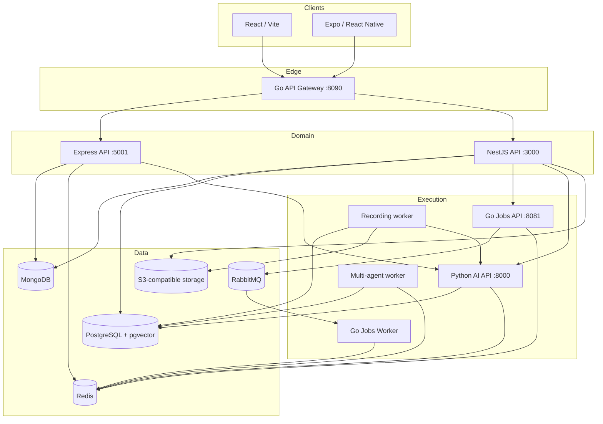

# Relay System Architecture

## 1. Architectural overview

Relay is a service-oriented collaboration and operational intelligence platform delivered from a polyglot monorepo. Browser and native clients consume a set of domain APIs. A Go HTTP gateway provides a controlled external route surface. Express and NestJS own distinct application domains, while Go and Python runtimes provide asynchronous execution and AI capabilities.

The architecture separates:
1. presentation and device capabilities;
2. public HTTP and realtime ingress;
3. domain API ownership;
4. background and model-driven execution;
5. persistence, messaging, and object storage;
6. infrastructure and operational telemetry.

The diagram represents logical relationships. Environment-specific network routes, enabled resources, and replica counts are defined by Compose and Kustomize manifests.

## 2. Service ownership

| Component | Runtime | Primary responsibility | Canonical path |
|---|---|---|---|
| Web | React/Vite | Browser interaction, navigation, operational workspace | `apps/web/` |
| Mobile | Expo/React Native | Native collaboration, notifications, call/media interaction | `apps/mobile/` |
| API Gateway | Go `net/http` | Route allowlist, reverse proxy, request IDs, security headers, gateway health and metrics | `services/api-gateway/` |
| Express API | Node/Express | Auth, users, messaging, notifications, Socket.IO, selected AI/incident routes | `services/express-api/` |
| NestJS API | NestJS/GraphQL | Conversations, tasks, calls, job facade, recording upload lifecycle | `services/nest-api/` |
| Jobs API | Go/Gin | Internal job submission, status, history, worker health | `services/jobs-api/` |
| Jobs worker | Go/AMQP | Queue consumption, job execution, idempotency, retries, heartbeat | `services/jobs-worker/` |
| AI API | Python/FastAPI | RAG, incident intelligence, conversation analysis, multi-agent task API | `services/ai-service/` |
| Multi-agent worker | Python | Durable multi-agent task execution | `services/ai-service/app/multi_agent/` |
| Recording worker | Python | Recording processing and transcription | `services/ai-service/app/recordings/` |

## 3. Public ingress and routing

The Go gateway is configured with upstream URLs for Express, NestJS, Go Jobs API, and Python AI. Its implemented route table is intentionally narrower than the set of configured upstreams.

| Public path | Upstream | Contract owner |
|---|---|---|
| `/api`, `/api/` | Express | Express routes |
| `/socket.io/` | Express | Socket.IO server |
| `/jobs`, `/jobs/` | NestJS | NestJS jobs controller |
| `/graphql`, `/graphql/` | NestJS | NestJS GraphQL schema |
| `/calls`, `/calls/` | NestJS | Call recording HTTP controller |
| `/docs`, `/docs/` | NestJS | NestJS Swagger UI |
| `/health`, `/health/` | NestJS | NestJS health controller |
| `/healthz` | Gateway-local | Gateway liveness |
| `/readyz` | Gateway-local | Express and Nest readiness probe |
| `/gateway/docs`, `/gateway/openapi.json` | Gateway-local | Gateway documentation |

The Go Jobs API and Python internal endpoints are not directly exposed by this gateway route table. Internal service URLs in environment configuration do not create public routes.

The gateway validates or generates request identifiers, emits security headers, sanitizes forwarded metadata according to trusted proxy CIDRs, and uses bounded HTTP transports. Upstream failures are normalized to a gateway `502` response.

## 4. Application API boundaries

### Express
Express is the HTTP and realtime collaboration service. It composes authentication, message, notification, incident, AI, and internal call-event routes. MongoDB/Mongoose provides document persistence; Redis supports selected coordination and rate-limit functions. Socket.IO handles authenticated realtime connectivity.

### NestJS
NestJS provides GraphQL resolvers for conversations, tasks, and calls, plus REST controllers for health, jobs, recording upload lifecycle, and internal media-session authorization. The service integrates PostgreSQL/Prisma, MongoDB/Mongoose, Redis, the Go Jobs API, the Python AI API, and S3-compatible recording storage according to feature.

### Python AI
FastAPI groups routes into versioned API, incident intelligence, conversation analysis, document retrieval, and multi-agent task modules. Internal bearer authentication protects AI APIs; tenant resolution uses the Relay user identity header as an additional scope input. PostgreSQL/pgvector persists tenant-scoped retrieval and workflow state.

## 5. Asynchronous execution

The Go job path separates submission from processing:
1. the Jobs API validates an internal request and supported job type;
2. it creates initial status state in Redis where configured;
3. it publishes a persistent RabbitMQ message and waits for publisher confirmation;
4. the Go worker consumes with manual acknowledgement and bounded prefetch;
5. the worker applies idempotency/status coordination and handles the supported job;
6. retry queues use TTL/dead-letter routing; exhausted or malformed work is directed to a dead-letter queue;
7. heartbeat keys expose worker liveness to the Jobs API.

The multi-agent path uses durable task records and a dedicated Python worker. The recording path uses a separate worker process to retrieve stored audio, transcribe it, and coordinate AI analysis.

## 6. Data architecture

| Store | Data class and role |
|---|---|
| MongoDB | Express-oriented users, messages, notifications, and related application documents |
| PostgreSQL | Relational AI/domain records, tenants, documents, chunks, incidents, and multi-agent tasks |
| pgvector | Embedding vectors and similarity retrieval within PostgreSQL |
| Redis | Cache, rate limiting, transient coordination, job status/idempotency, and worker heartbeat according to service |
| RabbitMQ | Durable asynchronous message transport |
| S3-compatible object storage | Call-recording objects and related media artifacts |

Data ownership is service-specific. Cross-store operations are not automatically atomic; workflows must use explicit state transitions, idempotency, and reconciliation where they span multiple persistence systems.

## 7. Identity and trust boundaries

Browser sessions use the server's cookie-based authentication contract. The native client uses bearer JWTs for HTTP and supplies a token in the Socket.IO handshake. NestJS GraphQL resolvers use authenticated guards and derive the acting user from the verified request context. Internal AI and jobs endpoints use dedicated bearer tokens.

Tenant-aware Python operations require both internal service authentication and a Relay user identity used to resolve the tenant. The identity header is not a substitute for validating the calling service. Authorization must be enforced at the domain/data-access boundary.

## 8. Operational topology

`compose.yaml` defines a local multi-container topology, including MongoDB, PostgreSQL, Redis, RabbitMQ, RustFS, Express, NestJS, the Go gateway, jobs services, Python AI, workers, frontend, Prometheus, Grafana, Blackbox Exporter, and cAdvisor.

`infrastructure/kubernetes/` contains a Kustomize base plus local and AWS overlays. The AWS overlay composes cloud-specific resources and workload configuration. Terraform under `infrastructure/aws/terraform/` defines selected AWS resources, ECR repositories, S3 recording storage, IAM roles/policies, and EKS Pod Identity associations.

## 9. Observability

The platform includes Prometheus instrumentation in the gateway and application services, service health/readiness endpoints, worker heartbeats, and a monitoring stack definition. Operational interpretation should distinguish process liveness, dependency readiness, queue progress, and successful user journeys.

## 10. Architecture evolution

API routes, event schemas, database structures, queue contracts, environment variables, and deployment labels are all compatibility surfaces. Changes should be versioned and reviewed across their producers and consumers. Architecture decisions are recorded in `docs/decisions/`.
