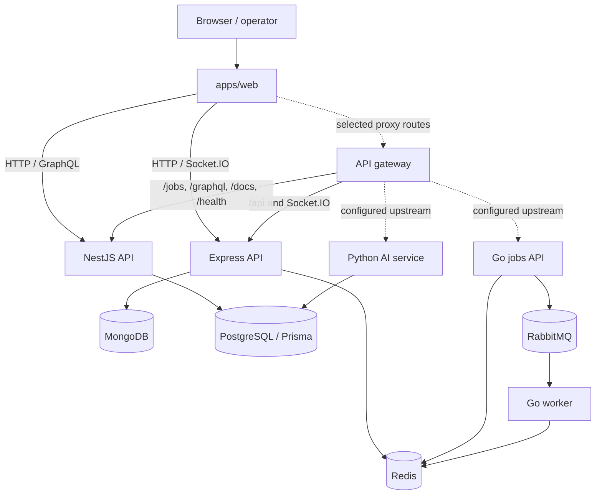

# Relay Architecture

## 1. Scope and confidence model

Relay is a polyglot application monorepo composed of a browser client, HTTP/GraphQL APIs, an API gateway, an asynchronous job API and worker, an AI/RAG service, and stateful infrastructure.

This document describes the repository as delivered in the source archive and the structural changes applied in this reorganization. It does not certify end-to-end behavior. Four kinds of statements must remain distinct:

1. **Source fact** — code or configuration exists at a known path.
2. **Configured behavior** — a manifest, environment variable, route, or dependency declares behavior.
3. **Verified behavior** — a reproducible test or manual scenario passed in a named environment and commit.
4. **Operational guarantee** — an explicitly designed and tested property such as durability, availability, tenant isolation, or recovery.

A configured route is not automatically a tested route. A passing unit test is not proof of a deployed integration. A Kubernetes manifest is not evidence that a cluster exists or that the manifest was applied successfully.

## 2. Repository topology

```text
apps/
  web/                         React/Vite client and Nginx configuration
services/
  api-gateway/                 Go reverse proxy and health/readiness handlers
  express-api/                 Canonical Express + Socket.IO service
  nest-api/                    NestJS API and GraphQL service
  jobs-api/                    Go HTTP API for job operations
  jobs-worker/                 Go RabbitMQ consumer/worker
  ai-service/                  Python FastAPI and AI/RAG workflows
archive/
  express-api-legacy/          Preserved duplicate source tree; not Compose canonical
infrastructure/
  deploy/                      Deployment assets
  devops/                      Jenkins support assets
  kubernetes/                  Kustomize base and overlays
docs/
tests/
compose.yaml                   Canonical local Compose entry point
```

The original archive contained both `backend/` and `express-api/`, each with an Express-oriented Node package. The root Compose configuration built `backend/`, so it is the canonical runtime implementation and is now located at `services/express-api/`. The other directory is preserved under `archive/express-api-legacy/`. This is a provenance-preserving choice, not a claim that the two implementations are equivalent. Before deleting or merging the archived tree, compare routes, middleware, migrations, dependencies, and tests in a separate reviewed change.

The root Compose file is intentionally retained at `compose.yaml`. This avoids a second canonical orchestration file and minimizes breakage for developer tools. Kubernetes resources live in `infrastructure/kubernetes/`.

## 3. Logical runtime model



The diagram combines logical service relationships described by source and configuration. Dashed arrows are intentionally qualified: configured upstream URLs do not prove that all upstream routes are currently exposed through the gateway. Confirm the exact `services/api-gateway/server.go` route table and `compose.yaml` environment before relying on an external path.

## 4. Service catalog and contracts

### 4.1 Web client — `apps/web/`

**Runtime:** React, Vite, browser JavaScript, and Nginx in containerized delivery.

**Responsibilities**
- Render user-facing application and operational interfaces.
- Invoke API interfaces and translate server responses into UI state.
- Maintain client-side interaction state without becoming an authorization boundary.
- Proxy selected paths through Nginx where configured.

**Constraints**
- All values embedded in a browser bundle are public, including `VITE_*` values.
- Route guards and hidden controls are UX controls, not access controls.
- Session expiry, network loss, stale optimistic state, duplicate real-time events, and API error bodies must be handled explicitly.
- Nginx upstream names must match service DNS identities on the active Compose network.

**Validation layers:** production build; component tests; browser E2E for critical flows; accessibility checks; proxy route checks; auth/session-expiry checks; and resilience tests for reconnect/error states.

### 4.2 Express API — `services/express-api/`

**Runtime:** Node.js, Express, Socket.IO, Mongoose, Redis client, authentication middleware, and related integrations declared in its package manifest.

**Responsibilities evidenced by repository structure and configuration**
- HTTP application endpoints, including authentication, messaging, incident and AI-related routes.
- Socket.IO real-time communication.
- MongoDB-backed data models.
- Redis integration and rate-limiting support.
- Internal calls to the Python AI service through configured base URL and internal token.
- Health endpoints intended to distinguish process health from dependency readiness.

**Trust boundaries**
- Validate identity and authorization for every protected operation at the service boundary.
- Treat request bodies, query strings, cookies, forwarded headers, socket payloads, and internal-service responses as untrusted input.
- Configure proxy trust only for known proxy hops.
- Ensure internal AI credentials are server-side only and never serialized into browser responses.
- Verify socket connection authentication, room membership, tenant scoping, and event authorization independently of HTTP middleware.

### 4.3 NestJS API — `services/nest-api/`

**Runtime:** NestJS, GraphQL/Apollo, validation and transformation libraries, Prisma client, and supporting Redis/Mongoose integrations declared by the service manifest.

**Responsibilities**
- GraphQL and application API operations.
- Job-related HTTP endpoints and API documentation routes.
- Guard, validation, and configuration modules.
- Relational data access through Prisma where configured.

**Design requirements**
- Enforce authorization at resolver/service/data-access boundaries; GraphQL field visibility alone is insufficient.
- Bound query depth, complexity, pagination, and resolver fan-out where applicable.
- Avoid N+1 data-access patterns and unbounded nested selections.
- Treat generated Prisma artifacts and migrations as versioned deployment inputs.
- Ensure schema evolution remains compatible with concurrently deployed clients and service versions.

### 4.4 Jobs API — `services/jobs-api/`

**Runtime:** Go HTTP API using Gin and RabbitMQ/Redis clients.

**Responsibilities evidenced by source files:** health and worker-health routes, job status handlers, middleware, and RabbitMQ integration.

**Operational requirements**
- Distinguish a job being accepted from a job being completed.
- Return stable job identifiers and explicit state transitions.
- Bound request payload size and downstream operation time.
- Apply authorization to internal job operations.
- Treat Redis/RabbitMQ reachability and application readiness as separate health dimensions.
- Verify whether queue publication is confirmed and what response is returned if publication fails.

### 4.5 Jobs worker — `services/jobs-worker/`

**Runtime:** Go worker with RabbitMQ and Redis integrations.

**Responsibilities:** consume asynchronous work, execute handlers, maintain status/idempotency-related state, reconnect to dependencies, and shut down cleanly, as reflected by the worker's source and tests.

**Delivery semantics must be established empirically.** A RabbitMQ consumer, retry loop, idempotency key, or status record alone does not establish exactly-once execution. At-least-once delivery can produce duplicates; workers should therefore make side effects idempotent, acknowledge only at the intended commit point, and distinguish retryable from terminal failures.

Review at minimum:
- acknowledgement timing and requeue behavior;
- bounded retries, backoff and dead-letter policy;
- duplicate delivery and idempotency-record expiry;
- crash windows between side effects and acknowledgement;
- reconnect behavior during broker restarts;
- graceful shutdown while a message is in flight;
- poison-message handling and queue growth;
- status-store unavailability and reconciliation.

### 4.6 AI service — `services/ai-service/`

**Runtime:** Python, FastAPI, SQLAlchemy async, Alembic, asyncpg, pgvector, LangGraph, LiteLLM, and MCP dependencies declared in requirements.

**Responsibilities:** AI-related HTTP workflows, document/knowledge ingestion, retrieval-augmented generation, and PostgreSQL-backed persistence where implemented.

**Security and quality requirements**
- Treat retrieved documents and model output as untrusted data, not executable instructions.
- Apply tenant and document authorization before retrieval, not only after generation.
- Record model/provider, prompt-template, embedding-model, chunking, and index configuration versions needed for reproducibility.
- Bound file size, decompression, chunk count, token budget, provider concurrency, and execution time.
- Redact sensitive content from traces and logs.
- Distinguish model-provider errors, retrieval failures, policy refusals, timeouts, and malformed outputs.
- Use migrations and explicit schema ownership; do not assume that a shared PostgreSQL instance implies a shared schema contract.

### 4.7 API gateway — `services/api-gateway/`

**Runtime:** Go HTTP reverse proxy. Compose configures upstream URLs for Express, NestJS, Go, and Python services. The gateway has local health and readiness endpoints, with explicit proxy route coverage in its server implementation.

**Gateway responsibilities**
- Provide a controlled entry point for the route set implemented in the gateway.
- Preserve intended HTTP semantics, request paths, headers, and response streaming.
- Bound upstream timeouts and response behavior.
- Return safe, consistent upstream-failure responses without leaking credentials or internal topology.
- Expose process health separately from dependency readiness.

**Important limitation:** configuration of Go and Python upstream URLs is not proof that all Go/Python routes are exposed through the gateway. Inspect the route table and add contract tests for every intended public path before advertising gateway coverage.

## 5. Data and messaging topology

| Dependency | Main role in this repository | Guarantees not implied by its presence |
|---|---|---|
| MongoDB | Express application persistence | Multi-region availability, backup integrity, schema compatibility, or tenant isolation |
| PostgreSQL | Relational and AI-service persistence; Prisma and SQLAlchemy/Alembic are present | Single-writer ownership, coordinated migrations, point-in-time recovery, or safe cross-service transactions |
| Redis | Cache, rate limiting, coordination and selected job status/idempotency state | Durable business records, global consistency, or safe loss of all keys |
| RabbitMQ | Asynchronous job transport between API/worker components | Exactly-once execution, unbounded retention, or guaranteed successful downstream side effects |

### Data ownership

The current repository includes multiple services and database clients. The existence of shared infrastructure does not establish that multiple services should share the same tables or collections. Before production use, document for each persisted entity:
- owning service and schema;
- authoritative write path;
- read paths and allowed projections;
- migration authority and compatibility window;
- retention and deletion rules;
- encryption and access-control requirements;
- backup and restore method;
- reconciliation behavior after partial failure.

Cross-service workflows should prefer explicit APIs or versioned events over direct writes into another service's private tables.

## 6. Local runtime and deployment configuration

`compose.yaml` is the canonical local container entry point. It declares MongoDB, PostgreSQL, Redis, RabbitMQ, Express, NestJS, web, Go API, Go worker, Python AI service, and gateway components. Some host ports bind to loopback, which reduces accidental LAN exposure but is not a substitute for host firewalling or service authentication.

`infrastructure/kubernetes/` contains Kustomize base resources and local/AWS overlays. Treat these manifests as deployment inputs requiring validation, image provenance, secret management, resource sizing, probes, network policy, persistence configuration, and a tested rollback plan. Rendering successfully is not equivalent to applying successfully; applying successfully is not equivalent to a healthy release.

## 7. Failure domains and recovery

The principal independent failure domains are:
- browser delivery and client state;
- gateway process and upstream routing;
- each API service;
- each stateful data dependency;
- RabbitMQ publication, delivery, and consumer execution;
- AI provider and retrieval/index pipeline;
- deployment configuration and secret distribution.

Every critical workflow should have an explicit timeout budget, error classification, retry policy, idempotency boundary, observable correlation identifier, and operator response. Retry only operations that are safe to repeat. Do not retry authorization failures, malformed requests, or non-idempotent side effects without an idempotency mechanism.

## 8. Observability contract

For each service, define:
- **Liveness:** whether the process is alive and can make progress.
- **Readiness:** whether the instance should receive the traffic it is responsible for.
- **Dependency health:** which dependencies are reachable and whether they are required for this operation.
- **Structured logs:** timestamp, service, severity, event, request/correlation ID, and safe error class.
- **Metrics:** request rate, error rate, latency distribution, saturation, queue depth/age, worker throughput, retries, and dependency pool health.
- **Tracing:** trace context propagation across HTTP, queue publish/consume, database calls, and AI-provider calls where supported.
- **Audit events:** security-sensitive changes, authorization failures, administrative actions, and data access events where required.

Health endpoints should not expose secrets, raw exception details, customer data, or unrestricted dependency metadata.

## 9. Security boundaries

- The browser and user-controlled input are untrusted.
- Gateway reachability does not imply authorization.
- Internal service-to-service network access does not replace authentication and authorization.
- Queue messages must be validated and versioned like external API requests.
- Database credentials should be scoped per service and environment.
- Build-time frontend configuration is public.
- Kubernetes Secret objects require a secure secret-management strategy and encryption at rest; base64 encoding is not encryption.
- Logs and traces require redaction and retention controls.
- AI prompts, retrieved content, tools, and model outputs require separate trust-boundary analysis.

See [Security and Operations](security-and-operations.md) and [Production Guide](production-guide.md).

## 10. Architecture decision record expectations

Material architecture changes should record:
1. context and problem statement;
2. decision and alternatives considered;
3. consequences and trade-offs;
4. API/event/data contract impact;
5. migration and rollback strategy;
6. security and privacy impact;
7. observability and failure-mode changes;
8. validation evidence and unresolved risks.

Do not add abstractions, shared packages, distributed coordination, or platform dependencies without a concrete requirement and a maintenance owner.


## Native mobile client

The Expo React Native application lives in `apps/mobile`. It consumes the existing Express HTTP and Socket.IO APIs using a bearer JWT returned only by dedicated native login/signup routes; the browser client continues to use its existing HttpOnly cookie contract. The mobile app currently implements authentication, contact/presence browsing, text messaging, and AI answers/citations. It is not yet feature parity with all web operations routes. See [Mobile Architecture and Security](mobile-architecture.md) for token limitations, request contracts, resource budgets, and release gates.
