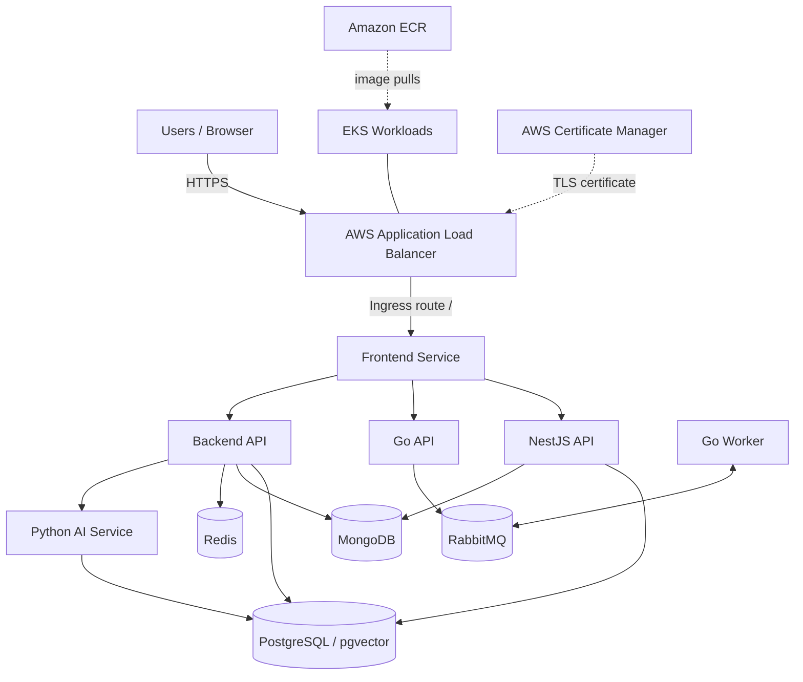

# Relay — AWS Deployment Architecture

> **Status:** Proposed architecture only. No AWS resources have been created by this documentation work.

## Architecture diagram

## Components

- **Amazon EKS:** Intended Kubernetes runtime for Relay workloads in the `relay` namespace.
- **Amazon ECR:** Intended registry for application images.
- **Application Load Balancer:** Created through the AWS Load Balancer Controller when the required AWS infrastructure and permissions are configured.
- **AWS Certificate Manager:** Provides the TLS certificate for the HTTPS listener.
- **Application services:** Web frontend, Express API, Go jobs API, Go jobs worker, NestJS API, and Python AI service. The current Kubernetes overlay does not include the API gateway.
- **Data and messaging:** MongoDB, PostgreSQL with pgvector, Redis, and RabbitMQ. Production hosting, persistent storage, and backups still require review.
- **AI inference:** The Python AI service needs an endpoint reachable from EKS. Replace local-only `host.docker.internal` configuration before deployment.

## Important deployment notes

The current Ingress manifest routes `/` to the frontend. Confirm and implement the required API routing before assuming the browser can reach each API directly. This diagram illustrates intended service dependencies, not verified Ingress routes or provisioned infrastructure.

Before deployment, configure the AWS account, Region, ECR image tags, domain, certificate ARN, secrets, storage, network access, and monitoring. Never commit credentials or secret values.

See [AWS overlay README](../../infrastructure/kubernetes/overlays/aws/README.md) and [AWS deployment checklist](../aws-deployment-checklist.md).
