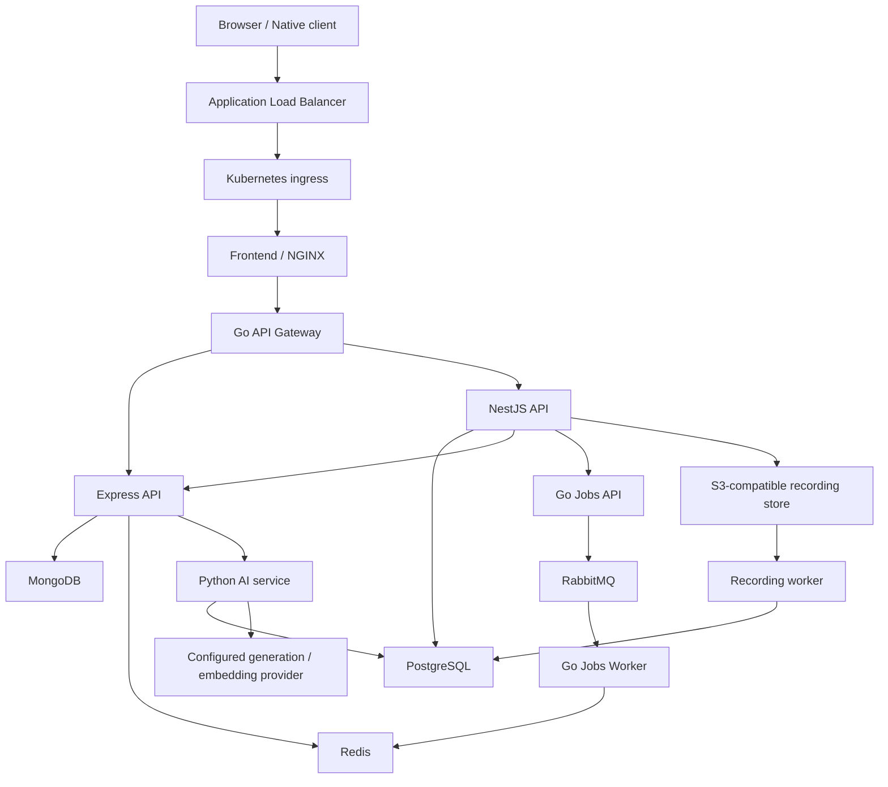

# Relay AWS Deployment Architecture

**Status:** deployment reference architecture and repository implementation map. The Terraform and Kustomize assets are configurable templates; their presence does not prove that an AWS account, EKS cluster, or production workload has been provisioned.

## 1. Intended deployment topology

The repository's AWS path is designed around:

- Amazon EKS for container orchestration;
- Amazon ECR repositories for application and selected supporting images;
- AWS Load Balancer Controller / ALB ingress for external HTTP entry;
- IAM workload identity through EKS Pod Identity for selected storage and secret-access roles;
- AWS Secrets Manager with External Secrets Operator for Kubernetes secret synchronization;
- S3 for call-recording objects when the corresponding optional infrastructure is enabled;
- PostgreSQL, MongoDB, Redis, and RabbitMQ workloads represented in the Kubernetes composition, with production operators expected to evaluate managed-service alternatives.

The design is a starting point. Production topology, managed-service decisions, network segmentation, data residency, and high-availability policy must be approved for the target organization.

## 2. Logical request path

This diagram describes intended relationships, not a statement that each edge is publicly exposed. The Go Gateway route allowlist is authoritative for external paths; Jobs API and Python AI are internal upstreams in the supplied gateway implementation.

## 3. Repository components

| Area | Path | Responsibility |
|---|---|---|
| Terraform foundation | `infrastructure/aws/terraform/` | optional VPC, EKS, ECR, recording bucket, and IAM resources with feature flags |
| IAM policies | `infrastructure/aws/iam/` | narrowly scoped workload policies for recording storage |
| Shared Kubernetes base | `infrastructure/kubernetes/base/` | common composition entrypoint |
| AWS overlay | `infrastructure/kubernetes/overlays/aws/` | namespace, resources, images, ingress, storage class, autoscaling patches |
| External secrets | `infrastructure/kubernetes/infra/external-secrets/` | ESO installation/configuration and SecretStore resources |
| Overlay renderer | `infrastructure/deploy/render-aws-overlay.py` | replaces account/region/image placeholders for the AWS overlay |

## 4. Terraform behavior and safety

Terraform variables use feature flags for optional creation. Notable defaults in the checked-in variable set include `create_ecr_repositories = false`, `create_recording_bucket = false`, `create_recording_iam_roles = false`, `create_external_secrets_iam_role = false`, and `create_vpc = false`; verify all flags and dependencies in the current Terraform source before planning. Optional EKS, endpoints, and NAT resources can incur charges.

Network profiles enforce availability-zone counts: cost-conscious and balanced expect two zones; high-availability expects three; custom permits a caller-defined topology within validations. Defaults are examples, not environment recommendations. Review CIDR plan, public/private subnet routing, NAT cost, VPC endpoints, cluster access, and egress before apply.

Never run `terraform apply` against a shared account without reviewing the saved plan, state backend, resource ownership, costs, IAM blast radius, and recovery plan.

## 5. Image publication and substitution

The AWS Kustomize overlay contains placeholder ECR account/region strings and `REPLACE_WITH_IMAGE_TAG`. The repository includes an overlay rendering helper and Go worker image publication workflow. Before deployment:

1. build and scan each image;
2. publish to the intended ECR account/region;
3. retain image digests;
4. substitute immutable version tags or digests;
5. render the overlay;
6. inspect the fully rendered manifest;
7. validate schema and policy before apply.

Do not deploy placeholder strings or mutable tags as a production release identity.

## 6. Networking and ingress

Review:

- ALB scheme and subnet placement;
- TLS certificate and minimum protocol;
- host/path routing and frontend fallback;
- WebSocket upgrade, idle timeout, and connection draining;
- gateway trust in forwarded headers and trusted proxy CIDRs;
- security groups and network policies between services;
- private database/broker endpoints;
- controlled egress to model providers and external APIs;
- health checks that align with readiness semantics.

Only the frontend and approved edge route should be internet reachable. Internal AI, Go Jobs API, databases, broker, worker, and metrics endpoints must remain private unless a reviewed access pattern requires otherwise.

## 7. Identity and secrets

The repository includes EKS Pod Identity trust-policy templates for selected service accounts, including Nest recording storage, recording worker storage, and External Secrets Operator. Use unique service accounts and least-privilege IAM roles. Avoid static AWS access keys in Kubernetes Secrets.

The External Secrets integration uses a SecretStore for AWS Secrets Manager. It expects secret names and namespace/configuration to align with Terraform and workload references. Validate every key mapping, role trust condition, region, and secret version before rollout.

## 8. Stateful services and storage

The AWS Kustomize overlay currently composes MongoDB, PostgreSQL, Redis, and RabbitMQ Kubernetes resources alongside RustFS/S3-compatible storage patterns. This may be appropriate for development or constrained environments but must not be assumed to be a production-grade managed-data design.

For production, explicitly select:

- managed vs self-managed PostgreSQL and MongoDB;
- backup, PITR, retention, encryption, and restore ownership;
- Redis durability and failover model appropriate to its use;
- RabbitMQ quorum/replication, disk alarms, and recovery;
- S3 bucket encryption, versioning, object lock/retention, lifecycle, access points, and replication;
- CSI storage class, volume expansion, and zone failure behavior.

## 9. Deployment workflow

1. establish account, region, IAM roles, network, cluster, and artifact registry;
2. run Terraform validation and review the plan;
3. provision foundation with explicit approvals;
4. install ingress controller, external-secrets operator, storage classes, and monitoring;
5. create Secrets Manager values and verify workload identity;
6. render the AWS overlay with concrete account, region, and image references;
7. run Kustomize build, schema validation, security policy checks, and diff review;
8. deploy data services and verify restore/backup before application traffic;
9. deploy workers and internal APIs;
10. deploy Gateway and frontend/ingress;
11. run health and synthetic user journeys;
12. record rollout evidence and operational ownership.

## 10. Production acceptance evidence

A credible AWS deployment record includes account/region, Terraform state reference, plan/apply logs, EKS version, node architecture, VPC/subnet design, image digests, rendered manifest digest, secrets mappings, IAM role trust, ingress/TLS, data-service choices, restore evidence, SLO dashboards, and rollback test.

## Related documents

- [AWS deployment checklist](../aws-deployment-checklist.md)
- [AWS overlay README](../../infrastructure/kubernetes/overlays/aws/README.md)
- [External Secrets integration](../../infrastructure/kubernetes/infra/external-secrets/README.md)
- [Backup and disaster recovery](../operations/backup-and-disaster-recovery.md)
