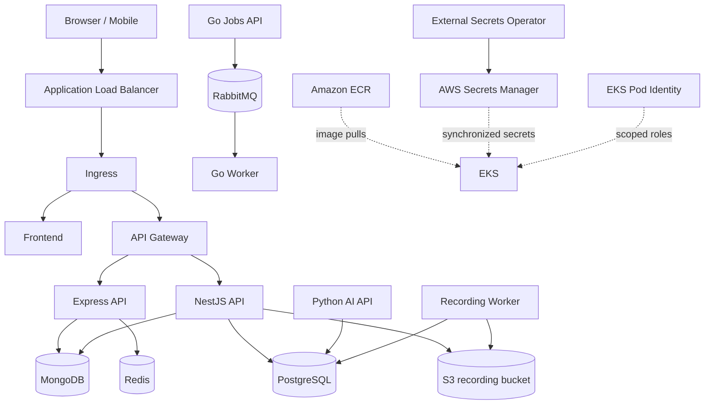

# Relay AWS Deployment Architecture

## Deployment model

The repository contains Terraform definitions for selected AWS resources and a Kustomize AWS overlay for Kubernetes workloads. The intended runtime is Amazon EKS with Amazon ECR image distribution, AWS Load Balancer Controller ingress, IAM workload identities, AWS Secrets Manager integration, and S3-compatible recording storage.

## Logical topology

## Infrastructure responsibilities

| AWS capability | Repository implementation |
|---|---|
| Container registry | Terraform ECR repositories with scan-on-push and encryption |
| Recording object store | Optional S3 bucket, public-access block, server-side encryption |
| Workload identity | IAM roles and EKS Pod Identity associations |
| Secrets delivery | External Secrets Operator resources and Secrets Manager trust policy |
| Ingress | AWS overlay ingress and Load Balancer Controller integration |
| Persistent volumes | AWS overlay storage class and stateful workload resources |

## Workload topology

The AWS overlay includes frontend, gateway, Express backend, NestJS API, Go API and worker, Python AI service, multi-agent worker, recording worker, and stateful infrastructure resources. Exact image names, service accounts, resource requests, probes, and environment variables are specified in the overlay manifests.

## Network and trust boundaries

Public ingress terminates at the configured load balancer and routes to selected services. Internal APIs and worker endpoints should remain cluster-private unless a specific route is intentionally published. Workload identities should be bound to exact namespace/service-account pairs. Database and broker ingress should be restricted to application workloads.

## Deployment workflow

1. Configure Terraform variables and remote state.
2. Initialize and validate Terraform.
3. Review a saved plan and cost/security impact.
4. Provision ECR, IAM, S3, and required EKS integrations.
5. Build and publish application images.
6. Configure External Secrets and Kubernetes service accounts.
7. Apply the AWS Kustomize overlay.
8. Verify rollout, ingress, storage, and service health.
9. Run application smoke tests and recovery validation.

The repository defines deployment assets; resource provisioning and production acceptance are performed in the target AWS account.
