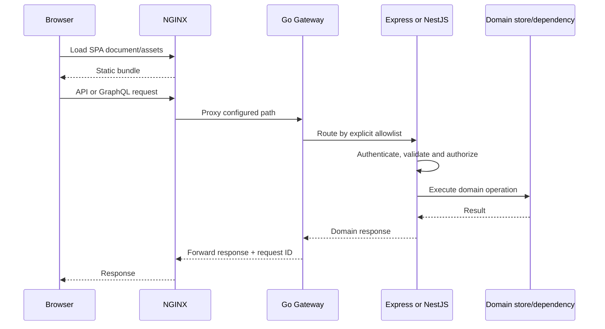
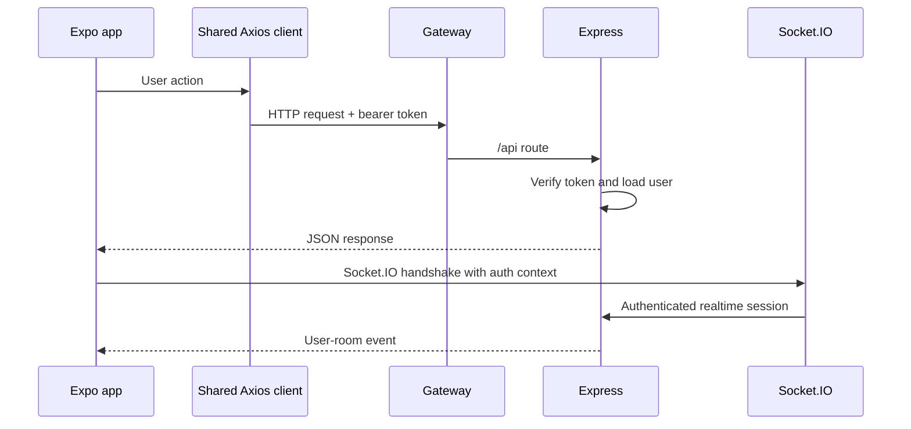
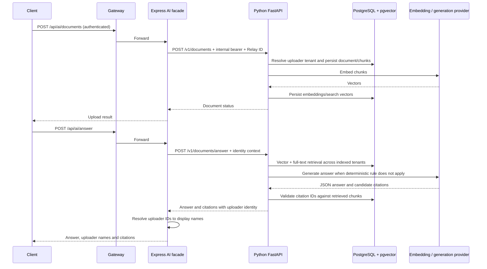
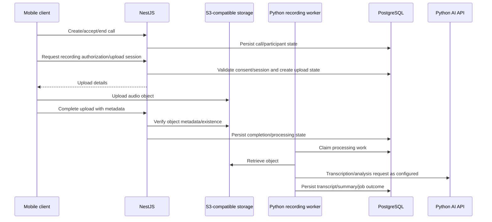
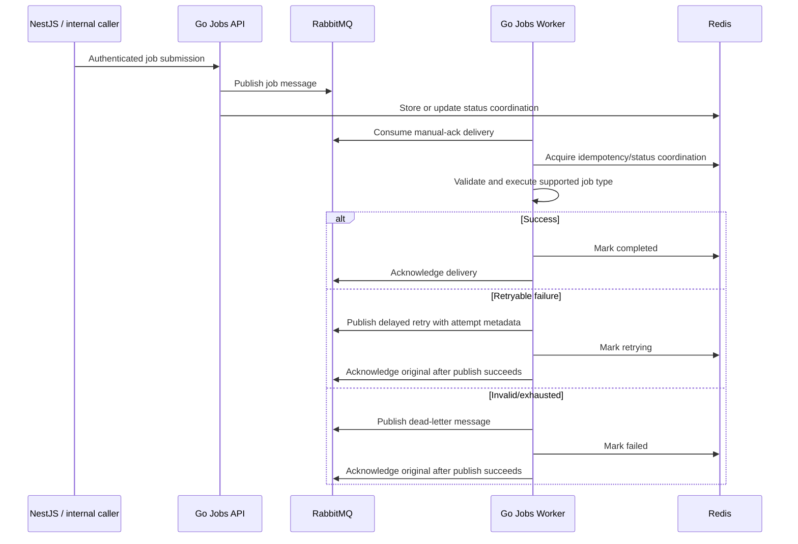
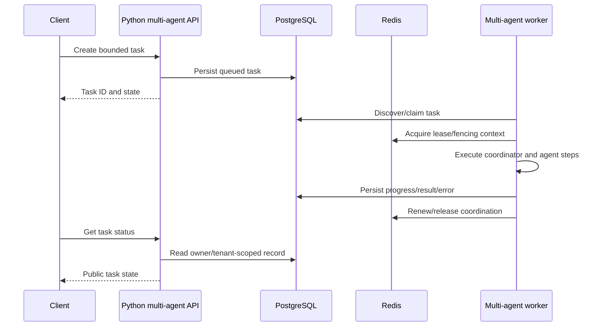

# Relay Request and Event Flows

This document traces the most important cross-service workflows. Exact payload contracts are defined by the route schemas and generated API specifications.

## 1. Browser navigation and API request

Browser cookie/session behavior is owned by the authenticated API. The Gateway does not create a second identity system. NGINX and Gateway have separate routing scopes; consult `apps/web/nginx.conf` and `services/api-gateway/server.go` together.

## 2. Native API and realtime path

HTTP and Socket.IO are different authorization surfaces. Test handshake identity, room membership, event routing and stale-session behavior separately from REST authorization.

## 3. Knowledge ingestion and global retrieval

**Access rule:** uploads, per-user document listing and direct document-by-ID retrieval are tenant-scoped. Search and answer currently retrieve across tenant IDs. This supports shared knowledge discovery but is not a per-document sharing ACL. The current code has no visibility/group permission filter at retrieval time. Do not use a global corpus for data that must remain isolated until an explicit ACL is implemented and tested.

## 4. Call and recording workflow

The exact upload sequence depends on the configured storage integration. Call ended, upload complete, object verified, transcript complete and summary complete are separate lifecycle milestones. Recovery and retry need to be tested across app restarts and worker restarts.

## 5. Go job workflow

At-least-once delivery requires idempotency. Verify that retry or DLQ publication succeeded before acknowledging the original delivery. The worker's currently supported job type is `welcome`.

## 6. Multi-agent task lifecycle

Task prompt, steps and timeout are bounded by the request contract. Internal worker lease information is not intended to be exposed in ordinary task responses.

## 7. Health and observability flows

- Gateway `/healthz` reports process liveness.
- Gateway `/readyz` probes Express and Nest readiness.
- Express readiness includes MongoDB connection state; a separate Redis probe exists.
- Nest exposes `/health` and `/health/ready`.
- Python exposes `/healthz` and `/readyz`; readiness checks service dependencies as implemented.
- Go Jobs API exposes liveness/readiness and worker heartbeat-related paths.
- Prometheus scrapes HTTP metrics and configured blackbox targets; workers publish heartbeat/state signals for API observation.

A healthy process probe must not be interpreted as proof that every user journey, provider call, queue, storage operation or worker is healthy.
