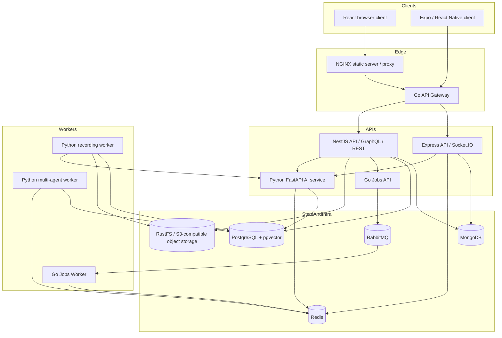

# Relay Enterprise Technical Dossier

**Audience:** engineering executives, platform and architecture leaders, hiring managers, staff/principal interviewers, technical recruiters, security reviewers, and technical due-diligence teams.
**Scope:** the repository snapshot supplied for documentation review.
**Purpose:** provide a source-grounded, end-to-end account of the product domains, architecture, service ownership, data flows, engineering practices, deployment assets, and maturity boundaries.

> **Interpretation rule:** “Implemented” means that executable source, tests, manifests, or a checked-in integration are present. It does not by itself prove that a feature is enabled in a particular environment, has been independently audited, has production traffic, meets an unstated SLO, or is deployed globally. This dossier deliberately distinguishes implementation evidence from operational claims.

---

## 1. Executive brief

Relay is a collaborative operations platform built as a multi-runtime monorepo. It combines a browser client and native mobile client with independent services for identity/collaboration, domain workflows, API routing, asynchronous jobs, AI/knowledge processing, recording processing, and platform observability.

The architecture is noteworthy for the separation of distinct workload classes:

1. **Interactive request/response workflows** are served by Express and NestJS APIs.
2. **Realtime collaboration** is delivered through Socket.IO and native/browser clients.
3. **Domain state** is persisted across MongoDB and PostgreSQL, with Redis used for bounded cache and coordination functions.
4. **Asynchronous jobs** are submitted through a Go API and processed by a Go RabbitMQ consumer.
5. **AI workflows** are isolated in Python, with separate HTTP integrations for RAG, conversation analysis, incident workflows, and multi-agent tasks.
6. **Media processing** is separated from the call control path; recording metadata and object storage are handled by NestJS and a dedicated Python worker.
7. **Platform assets** include a Go ingress gateway, Docker/Compose definitions, Kubernetes overlays, Terraform for AWS infrastructure, CI workflows, and Prometheus/Grafana configuration.

The system demonstrates end-to-end engineering across frontend design, mobile runtime concerns, multi-service API composition, authentication propagation, data modeling, vector retrieval, event-driven processing, infrastructure as code, test automation, and operations documentation.

### What this dossier does—and does not—claim

| Evidence category | What can be stated | What cannot be inferred from the repository alone |
|---|---|---|
| Application source | Routes, modules, data models, workers, UI screens, and service adapters exist in source. | That every source path is enabled or exercised in every environment. |
| Tests | Unit, integration, component, E2E, and infrastructure validation code exists in named areas. | That all tests pass on every branch or that all real-world scenarios are covered. |
| Containers | Dockerfiles and Compose services describe container build/runtime behavior. | That the images are deployed to a production registry or operate at global scale. |
| Kubernetes/Terraform | Kustomize overlays and Terraform resources describe deployment infrastructure. | That an AWS account, EKS cluster, ingress, secrets, or production database is provisioned. |
| Observability | Metrics middleware, Prometheus scrape configuration, blackbox probes, and Grafana provisioning exist. | That dashboards, alerts, paging, on-call ownership, or trace correlation are fully deployed. |
| Security | Authentication, service tokens, validation, route boundaries, and secret-management integration points exist. | Any SOC 2, ISO 27001, HIPAA, PCI DSS, GDPR certification or independent penetration-test result. |
| Reliability | Retry, idempotency, health, worker heartbeat, and recovery mechanisms are present in selected services. | A measured availability target, RTO/RPO, capacity ceiling, or disaster-recovery certification. |

## 2. Product and capability model

Relay is organized around a shared collaboration and operations experience rather than a single vertical feature.

| Product domain | User-facing capability | Backend realization | Evidence locations |
|---|---|---|---|
| Identity and profile | Account registration/login, session check, profile update, user discovery | Express authentication routes, Mongoose user model, JWT/cookie/bearer handling | `services/express-api/src/routes/auth.route.js`, `services/express-api/src/models/user.model.js` |
| Conversations and messaging | Conversation list, message history, send/edit/read operations, realtime updates | NestJS GraphQL conversation domain plus Express message routes and Socket.IO | `services/nest-api/src/conversations/`, `services/express-api/src/routes/message.route.js`, `services/express-api/src/lib/socket.js` |
| Notifications | Preferences, device-token registration, listing and read-state operations | Express notification routes/controllers and persistence | `services/express-api/src/routes/notification.route.js`, `services/express-api/src/controllers/notification.controller.js` |
| Calls and media | Call lifecycle, participant coordination, audio-only call type, recording consent, recording upload and processing | NestJS call domain, media-session endpoint, mobile media/recorder libraries, S3-compatible storage, Python recording worker | `services/nest-api/src/conversations/`, `apps/mobile/src/hooks/`, `apps/mobile/src/lib/`, `services/ai-service/app/recordings/` |
| Tasks and work | Task management, checklist items, activity and links | NestJS GraphQL task domain and Prisma models | `services/nest-api/src/conversations/tasks.*`, `services/nest-api/prisma/schema.prisma` |
| Asynchronous jobs | Internal job submission, history/status, worker health | NestJS facade, Go Jobs API, RabbitMQ, Go worker, Redis status/idempotency | `services/nest-api/src/jobs/`, `services/jobs-api/`, `services/jobs-worker/` |
| Knowledge assistant | Document ingestion, semantic/keyword search, grounded answer with citations and uploader attribution | Express facade, Python FastAPI, SQLAlchemy, PostgreSQL/pgvector, model provider adapters | `services/express-api/src/routes/ai.route.js`, `services/ai-service/app/rag/` |
| Incident intelligence | Incident creation, investigation, approval, execution, recovery | Python AgentOps routes and workflow modules, tenant model, evidence records | `services/ai-service/app/agentops/`, `services/ai-service/app/models/incident.py` |
| Conversation analysis | Structured summary, decisions, action items | NestJS/Express integration to Python conversation-analysis route | `services/ai-service/app/agentops/conversation_analysis.py`, `conversation_routes.py` |
| Multi-agent execution | Submit task, track state, inspect progress/result | Python API, PostgreSQL task records, Redis coordination, dedicated worker, provider adapters | `services/ai-service/app/multi_agent/` |
| Platform operations | Health/readiness, metrics, dashboards and infrastructure views | Gateway, service metrics, Prometheus, Blackbox Exporter, cAdvisor, Grafana configuration | `services/api-gateway/`, `monitoring/`, service observability modules |

### Capability status language

Use these terms in reviews and external discussions:

- **Implemented:** source code and corresponding contracts/models exist.
- **Tested in repository:** one or more test suites exercise a defined behavior; always name the suite and command.
- **Containerized:** a Dockerfile or Compose service exists.
- **Deployment-described:** Kubernetes/Terraform manifests exist and can be rendered or validated.
- **Environment-verified:** the target environment has been exercised with captured evidence.
- **Production-operated:** actual production traffic, incident history, on-call and SLO evidence exist.

Only the first four categories can be established from repository inspection alone. The final two require environment artifacts and operational records.

## 3. System context and runtime topology



### Ingress responsibilities

**NGINX** serves the compiled web SPA and forwards browser API paths, Socket.IO traffic, and selected diagnostic routes. Its route definitions are in `apps/web/nginx.conf`.

**Go API Gateway** is the application-routing layer. The current route allowlist is intentionally narrow:

| Public Gateway path | Upstream | Notes |
|---|---|---|
| `/api`, `/api/` | Express API | Collaboration, identity, notifications, incidents and Express AI facade |
| `/socket.io/` | Express API | Realtime transport; WebSocket upgrade is preserved |
| `/jobs`, `/jobs/` | NestJS API | Nest facade; Go Jobs API is an internal downstream |
| `/graphql`, `/graphql/` | NestJS API | GraphQL domain contract |
| `/calls`, `/calls/` | NestJS API | Call/recording REST contract |
| `/docs`, `/docs/` | NestJS API | NestJS Swagger UI |
| `/health`, `/health/` | NestJS API | Nest health endpoints |
| `/healthz` | Gateway-local | Process liveness |
| `/readyz` | Gateway-local | Probes Express and Nest readiness |
| `/gateway/docs`, `/gateway/openapi.json` | Gateway-local | Gateway contract documentation |

The Go Jobs API and Python AI API are not directly registered on the Go Gateway's public mux. The web NGINX file also contains local forwarding routes for `/go/readyz`, `/go/worker-health`, `/rabbitmqz`, `/python/readyz`, and Gateway health probes. Those are NGINX routes, not equivalent Gateway allowlist entries.

### Service communication patterns

- **Synchronous REST:** clients to Express/Nest; Express/Nest to Python; Nest to Go Jobs API.
- **GraphQL:** browser/native clients to NestJS for conversations, tasks, and calls.
- **Realtime:** clients to Express Socket.IO; domain events are routed into authenticated user rooms.
- **AMQP:** Go Jobs API publishes jobs; Go worker consumes RabbitMQ deliveries and uses Redis coordination.
- **Worker/database coordination:** Python multi-agent and recording workers use PostgreSQL/Redis and object storage as required.

The Gateway forwards requests; it is not intended to duplicate business validation or authorization policies owned by downstream services.

## 4. Service catalog and ownership

### 4.1 Browser client — `apps/web`

A React single-page application built with Vite. It contains authentication, chat, profile, AI, jobs, analytics, infrastructure and operational workspace pages. Zustand stores manage selected client-side state. Playwright provides a browser E2E entry point; Vitest and Testing Library cover components and utilities. The production Dockerfile builds static assets and serves them from NGINX as a non-root process.

### 4.2 Native client — `apps/mobile`

An Expo/React Native TypeScript application for Android and iOS. Screens cover authentication, conversations, calls, tasks, AI assistance, activity and notification preferences. Shared libraries provide the API client, GraphQL calls, Socket.IO lifecycle, offline message cache, audio recording, upload, and recording recovery. The client is a presentation/runtime boundary; server authorization remains authoritative. The Compose `mobile` service starts the Expo development server and is not a store-ready native release artifact.

### 4.3 Go API Gateway — `services/api-gateway`

A Go `net/http` application with explicit reverse-proxy mappings. It validates or generates `X-Request-ID`, propagates request identifiers, emits security response headers, derives forwarding metadata only through configured trusted proxy CIDRs, uses bounded upstream transports/timeouts, preserves WebSocket hijacking, and emits metrics. Gateway readiness checks Express and Nest readiness; it is not a probe of every internal dependency or worker.

### 4.4 Express API — `services/express-api`

An Express/Socket.IO service. Route composition includes `/api/auth`, `/api/messages`, `/api/notifications`, `/api/incidents`, and `/api/ai`; `/internal` accepts the internal call-event integration. MongoDB/Mongoose is the principal collaboration/user persistence layer; Redis supports selected coordination/cache/rate-limit functions. Middleware includes Helmet, credentialed CORS allowlisting, bounded JSON body parsing, cookie parsing, authentication, rate limiting, and Prometheus request metrics.

### 4.5 NestJS API — `services/nest-api`

A TypeScript/NestJS service combining GraphQL resolvers for conversations, tasks, and calls with REST controllers for health, jobs, AI, call recording uploads, and internal media-session authorization. Prisma models relational conversation/task/call/recording state in PostgreSQL. Mongoose integration is used for existing account identity, and Redis is used by selected service integrations. The NestJS jobs module calls the separate Go Jobs API. The AI controller calls the Python AI service using an internal token and carries the authenticated Relay user ID as tenant context.

### 4.6 Go Jobs API and Worker — `services/jobs-api`, `services/jobs-worker`

The API validates and publishes internal job requests, exposes job status/history and readiness/worker-health routes, and coordinates with RabbitMQ/Redis. Internal job endpoints use bearer authentication. The worker uses a main queue, delayed retry queues, and a dead-letter queue, with manual acknowledgements, bounded prefetch, retry publication, Redis idempotency/status/heartbeat coordination, reconnect handling and graceful shutdown. The currently implemented example job processor supports the `welcome` job type; this must not be described as a general-purpose business job catalog.

### 4.7 Python AI Service — `services/ai-service`

FastAPI hosts versioned health/status, document RAG, incident intelligence, conversation analysis and multi-agent task routes. SQLAlchemy async and Alembic manage AI-service PostgreSQL schema. PostgreSQL/pgvector stores chunk embeddings. Redis supports worker coordination. Provider adapters separate embedding selection from answer-generation selection. The API, multi-agent worker and recording worker run as separate Compose workloads/images.

### 4.8 Dedicated workers

- `multi-agent-worker` runs `python -m app.multi_agent.worker` from the AI-service image and processes persisted multi-agent tasks.
- `recording-worker` uses a separate Dockerfile and Python dependency set; it retrieves recording objects, transcribes audio and coordinates processing state.
- `jobs-worker` consumes RabbitMQ job messages and uses Redis for coordination/status.

Workers are not public HTTP APIs. Their readiness and heartbeat signals are distinct from web/API liveness.

## 5. Critical end-to-end flows

### 5.1 Browser request

1. Browser loads static assets from NGINX.
2. NGINX serves the SPA or proxies a configured route to the Go Gateway.
3. Gateway selects Express or Nest by the explicit route allowlist.
4. The owning service authenticates, validates, authorizes, executes domain logic and accesses its data store or internal dependency.
5. The response traverses the same proxy path to the browser.

The browser cannot infer authorization from client-side route visibility; the service boundary is authoritative.

### 5.2 Native authenticated request

1. Mobile uses `EXPO_PUBLIC_API_URL` configured for the device's network path.
2. The shared Axios client attaches the native bearer token.
3. REST requests go through the configured API origin; GraphQL and Socket.IO use their service contracts.
4. Expired, missing, deleted-account, and unauthorized session handling must remain aligned with server middleware.

A Metro connection proves JavaScript bundling, not that the device can reach the API origin.

### 5.3 Knowledge-base ingestion and answer

```mermaid
sequenceDiagram
  participant Client as Web / Mobile
  participant Gateway as Go Gateway
  participant Express as Express API
  participant AI as Python AI API
  participant DB as PostgreSQL + pgvector
  participant Model as Embedding / generation provider
  Client->>Gateway: POST /api/ai/documents (authenticated)
  Gateway->>Express: Forward /api request
  Express->>AI: POST /v1/documents + internal bearer + Relay user ID
  AI->>DB: Resolve uploader tenant; persist document/chunks
  AI->>Model: Generate chunk embeddings
  Model-->>AI: 768-dimensional vectors
  AI->>DB: Store chunks and vectors
  AI-->>Express: Document response
  Express-->>Client: Ingestion result
  Client->>Gateway: POST /api/ai/answer
  Gateway->>Express: Forward /api request
  Express->>AI: POST /v1/documents/answer + internal bearer + Relay user ID
  AI->>DB: Hybrid retrieval across indexed user documents
  AI->>Model: Generate grounded answer when deterministic rule does not apply
  Model-->>AI: Answer plus candidate citation IDs
  AI->>DB: Validate citation IDs against retrieved chunks
  AI-->>Express: Answer and citations with uploader identity
  Express->>DB: Resolve uploader IDs to Relay display names
  Express-->>Client: Answer, uploader names, citations
```

**Important data-access nuance:** document creation, document listing and document-by-ID lookup resolve the current Relay user's tenant. Search and answer call retrieval with no tenant filter in the current implementation, so retrieval can search across all indexed document tenants for an authenticated request. This is a platform-wide knowledge-sharing behavior, not document-level ACL enforcement. Retrieved chunks carry uploader identity; Express resolves it to display names. The uploader label is attribution, not an authorization control. Before introducing confidential or customer-isolated corpora, add explicit visibility/access policy, and enforce it inside retrieval queries—not merely in the UI.

RAG combines vector similarity and PostgreSQL full-text search with reciprocal-rank fusion. Chunk embeddings are 768-dimensional. Answer citations are validated against the set of retrieved chunks. A deterministic weekday closing-time rule answers a narrow operating-hours question from explicit hours evidence before generation; class-time questions still use the model path. This rule is a domain-specific guardrail, not a general proof of factual correctness.

### 5.4 Call and recording lifecycle

1. NestJS owns call lifecycle and participant state.
2. An internal media-session endpoint validates recording authorization/consent context.
3. Mobile handles media and local audio capture/recovery.
4. NestJS recording upload endpoints create or refresh uploads and validate completion metadata.
5. Recording bytes are stored through the configured S3-compatible/object-storage adapter.
6. The recording worker retrieves the object and performs transcription/analysis processing.
7. Processing metadata and state are persisted separately from the interactive call UI.

Call end, upload complete, object durable, transcription finished, and summary ready are distinct states. A successful call termination does not imply that downstream recording processing completed.

### 5.5 Asynchronous job lifecycle

1. An authenticated internal caller submits a validated job to the Go Jobs API (the NestJS API may act as the product-facing facade).
2. Jobs API publishes to RabbitMQ and persists or updates status coordination through Redis as implemented.
3. The Go worker consumes with manual acknowledgement and bounded prefetch.
4. The worker validates the payload and uses an idempotency key/record to avoid duplicate execution.
5. Failures are routed to delayed retry queues or a dead-letter queue; successful processing updates status before acknowledgement.
6. Worker health/heartbeat state is exposed through the Jobs API.

The queue topology supports reliability mechanics; the current business job handler remains deliberately narrow (`welcome`). Do not infer that every platform workflow is a supported Go job type.

### 5.6 Multi-agent lifecycle

1. The Python API validates a task, prompt, step limit and timeout bounds.
2. A task record is stored in PostgreSQL with tenant association and bounded progress/result fields.
3. Worker coordination uses Redis leases/claim state and fencing tokens.
4. The worker selects configured providers/agents, executes the task within limits, and updates progress/result/error state.
5. The API exposes task creation/list/detail with internal worker fields excluded from ordinary responses.

The exact provider and agent behavior is configuration-dependent. Treat generated output as untrusted and validate task state, IDs and response fields at the service boundary.

## 6. Data architecture and consistency

| Store | Repository role | Data examples | Consistency/ownership concerns |
|---|---|---|---|
| MongoDB | Document-oriented identity/collaboration persistence | User profiles, messages, notification preferences/state | Express/Nest account lookup must agree on Relay identity; use owner filters on user-specific reads/writes. |
| PostgreSQL | Relational domain and AI persistence | Conversations, tasks, calls, recordings, AI tenants, documents, chunks, incidents, multi-agent tasks | Migrations and transactional constraints are authoritative; Prisma and SQLAlchemy are separate service data layers. |
| pgvector | Vector search extension in PostgreSQL | 768-dimensional document chunk embeddings | Embedding model/dimension changes require schema and re-embedding strategy. |
| Redis | Low-latency cache and coordination | Rate limits, worker status, leases, heartbeat, idempotency, progress coordination | TTL/eviction semantics matter; do not treat cache state as durable business truth unless explicitly designed. |
| RabbitMQ | Durable asynchronous transport | Go job messages and retry/dead-letter traffic | Acknowledge only after safe processing or successful retry/DLQ publish; consumers must tolerate redelivery. |
| RustFS / S3-compatible storage | Binary object storage | Call recording objects in local/Kubernetes setups | Database metadata and object lifecycle must be recovered together; object authorization and retention require policy. |

### AI tenant and sharing model

The AI service has a `tenants` table with a Relay user ID mapping. `documents` and `document_chunks` carry tenant IDs. A composite foreign key ensures a chunk's `(tenant_id, document_id)` pair references a document under the same tenant. Incident and multi-agent task models also carry tenant ownership. In the current Knowledge Base flow:

- Ingestion associates a new document with the authenticated uploader tenant.
- List and direct document fetch remain scoped to the requesting user's tenant.
- Search and answer use cross-tenant retrieval to support the shared-corpus product behavior.
- Answer citations preserve an uploader ID so the Express layer can return a human-readable name.
- This shared retrieval scope currently has no per-document visibility field or ACL filter in the retrieval code. Treat the searchable corpus as shared among authenticated users and do not place confidential/segregated content in it without a future access-control design.

### Cross-store workflows

MongoDB, PostgreSQL, Redis, RabbitMQ and object storage do not share a distributed transaction. Each cross-service flow must define durable state, idempotency key, retry semantics, and recovery/compensation behavior. For recording, verify both metadata and object presence. For jobs, verify status and queue/consumer state. For identity, propagate a stable Relay user ID and resolve it to profile data at the trusted service boundary.

## 7. Security and trust boundaries

### Identity and authentication

- Express authentication uses the MongoDB `User` model and supports browser cookie/session flows plus native bearer-token flows.
- NestJS includes HTTP and GraphQL JWT guards and uses the existing Relay identity context.
- Python internal endpoints require a configured internal bearer token. Tenant context is passed separately in `X-Relay-User-Id`; this header is not a substitute for the internal bearer credential.
- Go Jobs API internal job routes require an internal bearer token.
- Socket.IO has its own handshake authentication and user-room authorization path; HTTP authorization tests do not replace realtime authorization tests.

### Request and service boundaries

- The Gateway uses an explicit public route allowlist and only trusts forwarded metadata from configured trusted proxy CIDRs.
- Express uses Helmet, credentialed CORS allowlisting, cookie parsing, bounded request bodies, authentication middleware, and route-specific rate limits.
- NestJS uses environment validation, Helmet, CORS, JWT guards, validation DTOs, request context and timing middleware, and a global exception filter.
- Python protected routes use `require_internal_token`; input schemas bound request fields and limits.
- Dockerfiles use non-root runtime users for the principal application containers.

### Enterprise review requirements

Before production use with sensitive or regulated data, independently review: shared Knowledge Base visibility, per-resource authorization, secrets manager policies, storage encryption and retention, JWT signing/rotation/revocation, session lifecycle, audit event retention, rate limits, abuse controls, container hardening, network segmentation, backups, restore tests, privacy notices, and applicable legal obligations.

This repository does not establish a certification or legal compliance position. Such claims require scope-specific evidence and independent review.

## 8. Reliability, failure semantics and operational model

Relay uses several reliability patterns, but they are service-specific rather than a universal platform guarantee:

- Gateway upstream timeouts and normalized upstream errors.
- Liveness/readiness separation in several services.
- Database readiness checks and dependency probes.
- Bounded HTTP payload sizes and request timeouts.
- RabbitMQ manual acknowledgement, retry queues, dead-letter routing and reconnect logic.
- Redis idempotency, lease and heartbeat coordination in workers.
- Recording upload recovery and separate processing states.
- Multi-agent task leases, bounded steps/timeouts and persistent state.
- AI citation ID validation, deterministic rule for a narrow time question, and provider timeout handling.

A service reporting healthy does not prove every downstream workflow is operational. For example, Gateway `/readyz` checks Express and Nest readiness, not all workers, all AI providers, or the recording object store. Prometheus probes are similarly scoped to the configured targets.

### SLO posture

The repository defines candidate service indicators, not numerical production SLOs. Availability, latency, error budget, RTO and RPO values must be established using observed traffic, workload profiles, business criticality and actual target infrastructure. Do not copy example targets into external collateral as measured commitments.

## 9. Deployment and delivery

### Local Docker Compose

`compose.yaml` defines MongoDB, PostgreSQL/pgvector, Redis, RabbitMQ, RustFS, Python AI API, multi-agent worker, recording worker, Express, NestJS, Go Jobs API, Go worker, Go Gateway, frontend NGINX, Expo Metro, Prometheus, Grafana, cAdvisor and Blackbox Exporter. Service ports, volumes, healthchecks, dependency order, and environment variables are declared in that file.

Important local host bindings include:

| Host port | Component | Container port |
|---:|---|---:|
| 8088 | Web frontend NGINX | 8080 |
| 8090 | Go API Gateway | 8090 |
| 8081 | Expo/Metro | 8081 |
| 5001 | Express API | 5001 |
| 3000 | NestJS API | 3000 |
| 8083 | Go Jobs API | 8081 |
| 8000 | Python AI API | 8000 |
| 5433 | PostgreSQL | 5432 |
| 27018 | MongoDB | 27017 |
| 5672 / 15672 | RabbitMQ AMQP / management | 5672 / 15672 |
| 9000 | RustFS API | 9000 |
| 9090 / 3001 | Prometheus / Grafana | 9090 / 3000 |

Most backend data/API ports are bound to `127.0.0.1`; the Gateway and some development services have broader host bindings. Do not reuse local Compose port exposure as a production network policy.

### Kubernetes and AWS

The repository includes a shared Kustomize base, local overlay, AWS overlay, workload manifests, persistent volume resources, ingress configuration, External Secrets Operator integration, and AWS Terraform for selected network/EKS/ECR/IAM/storage resources. The AWS Kustomize overlay contains placeholder account/region/image-tag values and requires environment-specific preparation. `kubectl kustomize` and schema validation prove manifest renderability, not cloud provisioning or successful service operation.

### CI and build automation

The repository includes GitHub Actions workflows for web CI, Go worker CI/publishing, Kubernetes validation, Terraform validation, and security/supply-chain checks. A Jenkinsfile is also present. The workflow files define the authoritative trigger branches and executed commands. There is not one workflow in the repository that proves every service, native device build, complete deployment, restore, and production smoke journey together.

## 10. Verification and evidence matrix

| Area | Repository evidence | Focused command (from root unless noted) | What the check establishes |
|---|---|---|---|
| Workspace dependency graph | `package.json`, `pnpm-workspace.yaml`, `pnpm-lock.yaml` | `pnpm install --frozen-lockfile` | Lockfile consistency and workspace dependency installation |
| Web | `apps/web/package.json`, component tests, Playwright config | `pnpm --dir apps/web run lint`, `pnpm --dir apps/web run test`, `pnpm --dir apps/web run build` | Static analysis, component/unit tests, production bundle build |
| Mobile | TypeScript config, ESLint and Expo scripts | `pnpm typecheck:mobile`, `pnpm --dir apps/mobile run lint` | Type correctness and linting; not physical-device behavior |
| Express | Node integration tests | `pnpm test:express-api` | Selected Express route/middleware/realtime integrations |
| NestJS | Vitest and E2E config | `pnpm test:nest-api`, `pnpm test:e2e:nest-api` | Selected Nest services/resolvers/controllers and E2E behavior |
| AI | `services/ai-service/tests/`, pytest config | `pnpm test:ai-service` | Python tests when the expected service virtualenv exists |
| Go services | Go modules and test suites | `pnpm test:api-gateway`, `pnpm test:jobs-api`, `pnpm test:jobs-worker` | Go unit/integration tests compiled into module suites |
| Kubernetes | Kustomize overlays and workflow | `kubectl kustomize infrastructure/kubernetes/overlays/aws` | Manifest rendering only |
| Terraform | Terraform source and tests | `terraform fmt -check -recursive`, `terraform validate`, `terraform test` from `infrastructure/aws/terraform/` | Formatting, static configuration and declared Terraform tests |
| Compose | `compose.yaml`, Dockerfiles | `docker compose config`, `docker compose up -d --build`, `docker compose ps` | Compose resolution and local container startup/health as reported by configured probes |

For any externally shared verification claim, record commit SHA, toolchain version, environment, exact command, exit code and retained report/log artifact.

## 11. Technical due-diligence checklist

A serious enterprise review should ask for evidence beyond the code repository:

### Architecture and scale
- What request volume, active connections, concurrent calls and job throughput have been measured?
- Which services are scaled horizontally today, and which stateful dependencies remain single failure domains?
- How are connection pools, queue prefetch, worker concurrency, model concurrency and timeouts tuned?
- What are measured tail latencies for API, GraphQL, realtime delivery, retrieval and recording processing?

### Security and privacy
- Is the shared RAG corpus appropriate for every authenticated user's data classification?
- Are document ACLs, visibility groups, retention and deletion propagation defined?
- How are JWTs rotated/revoked, sessions invalidated, and internal service credentials rotated?
- Are data stores encrypted at rest and in transit in the deployment environment?
- Are access/audit events retained, protected and reviewed?
- Has an independent penetration test or threat-model review been completed?

### Reliability and operations
- What numerical SLOs are approved, and what dashboards measure them?
- What are tested RTO/RPO values for PostgreSQL, MongoDB, objects and queued jobs?
- Are backups immutable and restore exercises recurrent?
- Who owns on-call response, escalation, incident communications and postmortem closure?
- Are dead-letter queues monitored and replay procedures tested?

### AI governance
- Which model/provider and embedding model are configured per environment?
- How are model changes evaluated for retrieval relevance, answer accuracy, latency and cost?
- Are hallucination, injection, data-exfiltration and cross-document leakage tests maintained?
- How are prompt/version changes, citations, abstention, and deterministic rules evaluated?
- Are provider data-retention and geographic-processing terms acceptable for the data involved?

### Delivery and software supply chain
- Are all services built and scanned from the same release commit?
- Are images signed, promoted by immutable digest, and tied to provenance/attestation?
- Are dependency upgrades, SBOMs, vulnerability exceptions and container base-image refreshes governed?
- Are migrations backward-compatible and deployment rollback rehearsed?

## 12. Hiring and evaluation guide

### For engineering executives
Focus on service ownership, system boundaries, data consistency, security posture, measurable reliability, release governance, and the gap between implementation assets and production evidence.

### For hiring managers
Use the capability matrix in [Engineering Portfolio](engineering-portfolio.md). Ask the candidate to trace one request end to end, explain why each runtime exists, identify a failure domain, and propose a safe migration or reliability improvement.

### For technical recruiters
Relay supports credible discussion of full-stack product engineering, mobile application architecture, backend APIs, realtime systems, distributed workers, AI/RAG systems, PostgreSQL/pgvector, cloud infrastructure, IaC, security engineering and SRE practices. Recruiter descriptions should say “implemented in the repository” or “deployment assets included” unless actual operating evidence is available.

### Suggested technical interview prompts
1. Trace a mobile message or call request from the client through ingress to persistence and realtime delivery.
2. Explain why the Go Gateway route allowlist does not directly expose Python AI or Go Jobs APIs.
3. Explain the difference between user-owned document ingestion/listing and shared-corpus answer retrieval.
4. Design per-document authorization for an enterprise knowledge base without weakening query performance.
5. Describe the failure modes between recording upload completion, object persistence and transcription.
6. Explain retry, DLQ, idempotency and acknowledgement order in the Go worker.
7. Define measurable SLOs and the telemetry required to operate the system.

## 13. Source-of-truth index

| Topic | Authoritative source locations |
|---|---|
| Workspace scripts | `package.json`, `pnpm-workspace.yaml` |
| Local topology | `compose.yaml` |
| Gateway routes/config | `services/api-gateway/server.go`, `config.go` |
| Browser proxy | `apps/web/nginx.conf`, `apps/web/Dockerfile` |
| Express route/security behavior | `services/express-api/src/app.js`, `src/routes/`, `src/middleware/` |
| Nest domain and schema | `services/nest-api/src/`, `services/nest-api/prisma/schema.prisma` |
| Jobs contract and worker | `services/jobs-api/`, `services/jobs-worker/` |
| AI routes/provider/security | `services/ai-service/app/`, `requirements.txt`, migrations |
| Infrastructure | `infrastructure/kubernetes/`, `infrastructure/aws/terraform/` |
| CI and security workflows | `.github/workflows/`, `Jenkinsfile` |
| Monitoring | `monitoring/`, service metrics modules |

The source and generated API schemas remain authoritative where a documentation statement conflicts with executable behavior. Update this dossier whenever a service boundary, access model, schema, deployment target, or operator workflow changes.
