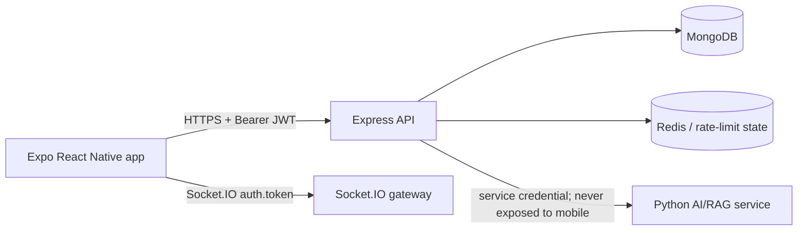

# Relay Mobile Architecture and Security

## Scope

`apps/mobile` is an Expo-managed React Native client that reuses the Express API's account, messaging, presence, and AI answer contracts. The mobile application is a separate presentation client, not a new trust boundary or source of authorization truth.

## Context and request flow

The mobile app calls `POST /api/auth/mobile/login` and `POST /api/auth/mobile/signup`, then sends the returned token in the HTTP `Authorization` header and Socket.IO handshake authentication payload. Existing web endpoints keep their original response shape and cookie-based session behavior. The same server-side JWT verification and account lookup enforce identity for both clients.

## Client module boundaries

- `App.tsx`: session restoration, secure token lifecycle, navigation boundary, and socket lifecycle.
- `src/lib/api.ts`: API base URL, bounded HTTP timeout, bearer injection, and sanitized request errors.
- `src/lib/realtime.ts`: one authenticated Socket.IO connection and its cleanup.
- `src/screens/AuthScreen.tsx`: login and signup input validation and native API interaction.
- `src/screens/ConversationsScreen.tsx`: contacts, presence, refresh, and navigation.
- `src/screens/ConversationScreen.tsx`: paged endpoint contract (initial 50-message fetch plus cursor-based older-page loading), real-time incoming events, duplicate suppression, and bounded text composition.
- `src/screens/AIAssistantScreen.tsx`: AI request and citation rendering.
- `src/components/`: shared screen, input, button, heading, and avatar primitives.

Keep API contracts in the service, transport details in `src/lib`, and view state in screens. Avoid duplicating domain policy or trusting client-supplied user IDs for authorization.

## Authentication and threat model

### Protected assets

Account credentials, bearer tokens, private messages, profile information, knowledge documents, AI prompts and answers, and service-internal credentials.

### Trust boundaries

- The device may be lost, rooted, jailbroken, inspected, or run with instrumentation.
- Network requests may be observed or modified if transport security is misconfigured.
- API payloads and socket events are untrusted input even after transport authentication.
- A valid token proves a signed identity claim; each endpoint must still authorize the requested action and enforce tenant ownership.
- The mobile bundle and every `EXPO_PUBLIC_*` value are public. The Python AI service token, database credentials, signing keys, and provider secrets must never be bundled.

### Controls in this implementation

- HTTPS is required for production configuration; local HTTP is for development only.
- Device credentials are stored using Expo SecureStore and are not persisted to AsyncStorage or logged.
- Bearer tokens are passed only in authorization headers or Socket.IO's authentication payload, never query strings.
- The API client applies a 12-second default timeout and constrains visible error messages.
- Backend validation, rate limits, JWT verification, user existence checks, and AI service credential isolation remain server responsibilities.
- AI's origin middleware permits an originless request only if it carries a bearer credential. CORS is not authentication and does not replace bearer verification.

### Known session limitation and required next step

The existing token issuer creates seven-day JWTs and has no server-side revocation record. Native logout deletes the locally stored token but cannot invalidate a token copied off-device. Do not describe this as immediate revocation. Before production use with sensitive accounts, implement a dedicated session lifecycle: short-lived access JWTs with explicit audience/issuer and unique `jti`, rotating refresh tokens stored as hashes server-side, refresh-family reuse detection, device/session listing and revocation, logout/revoke endpoints, and tests for replay, expiry, rotation races, and account disablement. Consider platform attestation and step-up/biometric gating based on the threat model; biometrics must gate local key access rather than replace server authentication.

## Reliability and realtime semantics

- The API remains the source of truth for messages. Socket events are best-effort notifications and can be missed during backgrounding, network handoff, or server restart.
- Reconnect does not imply event replay. Refresh conversation history after reconnect/foreground before claiming the timeline is synchronized.
- The current client de-duplicates messages by `_id`, but it does not implement an offline outbox, idempotency keys, delivery receipts, or durable retries.
- The screen loads the latest bounded message batch; the native client can fetch older pages using `x-has-more` and `x-next-cursor`; it still needs explicit reconciliation after reconnect and a durable outbox before claiming offline delivery.
- AI answers can exceed the client timeout. Prefer an asynchronous execution resource with a request ID, poll/subscribe status, cancellation semantics, and bounded retries for slow inference rather than retrying expensive inference blindly.
- Errors should be actionable but must not expose tokens, internal hostnames, raw exception stacks, prompts from other users, or provider credentials.

## CPU, memory, and battery budgets

Treat these as proposed engineering budgets, not measured guarantees; establish baselines on representative physical devices before release.

| Area | Initial policy | Validation |
|---|---|---|
| API requests | 12-second default timeout; one in-flight AI request per screen | Network traces and slow-network tests |
| Message payload | Text at most 5,000 characters; no image upload in initial slice | Boundary tests and request-size inspection |
| AI prompt | At most 2,000 characters; top-k fixed at 5 | API validation and latency/cost telemetry |
| Lists | `FlatList` virtualization; no full-screen unbounded message rendering | Long-history profiling and JS heap snapshots |
| Realtime | One shared socket per authenticated app session | Listener-count assertions, reconnect soak test |
| Local persistence | Credential only; no cached private chat transcript | Device storage inspection and privacy review |
| Background | No polling loop; Socket.IO lifecycle managed at session scope | Battery/network profiler and app lifecycle tests |

Avoid premature memoization. Profile render counts, JS-thread stalls, native memory, startup time, and network wakeups on low-end supported devices. Add paging, event batching, backoff with jitter, and background suspension based on measured bottlenecks.

## Configuration and deployment

`EXPO_PUBLIC_API_URL` is a public build-time setting ending in `/api`. It must resolve from the device itself. Android emulator `localhost` points to the emulator; use `10.0.2.2` to reach the host machine. Physical devices require a reachable LAN address for local testing or a public/private HTTPS endpoint appropriate to the deployment. Never disable TLS verification to work around certificate errors.

Production release gates should include dependency/license review, secret scanning, Expo/native dependency compatibility, signed reproducible builds, least-privilege API scopes, session revocation tests, OWASP MASVS-aligned mobile testing, jailbreak/root threat assessment, privacy disclosures, accessibility verification, and an incident response process for credential compromise.

## Compatibility contract

- Existing browser authentication endpoints continue returning their existing public user JSON without a bearer token.
- Native endpoints share the same login/signup rate limiters and validation.
- HTTP protected routes accept either the established `jwt` cookie or an explicit `Authorization: Bearer` token.
- Socket.IO accepts either the established browser cookie or `handshake.auth.token`; the token is verified before user presence is registered.
- Mobile AI calls use the existing authenticated Express AI route. The internal Python service token remains server-side.

Any changes to token claims, expiry, API response fields, socket event payloads, or logout semantics must be coordinated across web/mobile clients and accompanied by contract tests.
