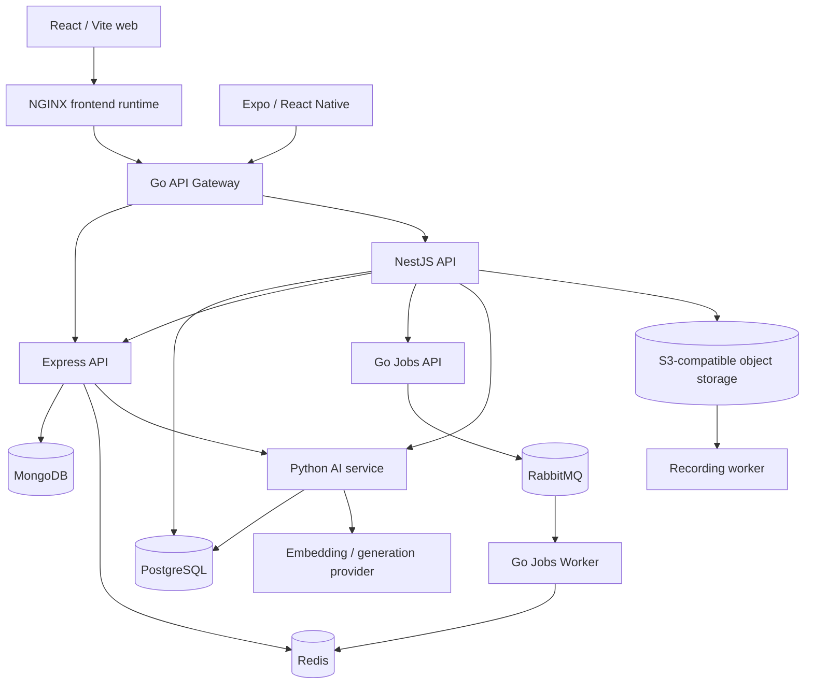

# Relay Platform Overview

**Relay** is a collaboration and operational-intelligence platform delivered through browser and native clients. Its architecture combines synchronous workspaces—identity, conversations, messages, tasks, calls, and notifications—with asynchronous processing for job execution, knowledge retrieval, AI analysis, and media workflows.

This document is the concise platform narrative. The [Enterprise Technical Dossier](docs/enterprise-technical-dossier.md) is the deeper architecture and due-diligence reference.

## 1. Product domains

### Collaboration workspace

- Account registration, login, and session-aware navigation.
- User discovery and conversation creation.
- Message composition, history, read state, and realtime delivery.
- Conversation membership and participation.

### Tasks and operational coordination

- Task creation and updates in conversation context.
- Checklist and task-link relationships.
- Task activity and domain state through the NestJS API and PostgreSQL.

### Calls and media workflows

- Call lifecycle, participants, signaling, and media-session authorization.
- Recording-consent decisions and recording upload lifecycle.
- Recording tracks, transcripts, and generated summaries through asynchronous processing.

### Knowledge and AI

- Document ingestion, chunking, embeddings, vector and full-text retrieval.
- Evidence-grounded answers with server-validated citation IDs and abstention behavior.
- Shared cross-user Knowledge Base retrieval in the current implementation: authenticated users can retrieve documents uploaded under other Relay users' workspaces. Upload/list/direct document access remain owner-scoped. This distinction is a product data-sharing policy and must be reviewed and communicated clearly.
- Incident investigation, conversation analysis, and bounded multi-agent task workflows.

### Background execution

- Go Jobs API publishes supported job messages to RabbitMQ.
- Go Jobs Worker consumes and processes the supported job contract with Redis-backed idempotency/status and retry/recovery logic.
- Separate Python workers handle multi-agent execution and recording processing.

## 2. Client and service topology

The diagram describes component relationships. Public reachability is restricted by the Gateway's explicit path allowlist and NGINX proxy configuration; an internal upstream URL is not automatically a public route.

## 3. Architectural principles

- **Explicit ownership:** each runtime owns a bounded contract; the Gateway routes but does not replace service-level authorization.
- **Identity at trust boundaries:** clients authenticate to public APIs; internal services use separate internal credentials and propagated user identity where required.
- **Durable state separated from transient coordination:** PostgreSQL/MongoDB own application records; Redis coordinates cache/status/idempotency; RabbitMQ carries asynchronous messages; object storage carries large media artifacts.
- **Evidence-grounded AI:** retrieved material constrains responses; citations are checked against retrieved chunks; lack of support must lead to abstention or an explicit limitation.
- **Operational controls:** request limits, deadlines, health checks, bounded worker consumption, and metrics are first-class system concerns.
- **Polyglot where ownership warrants it:** TypeScript/Node, Go, and Python remain separately built and tested toolchains.

## 4. Technology map

| Layer | Current implementation |
|---|---|
| Web | React 19, Vite, NGINX |
| Mobile | Expo SDK 57, React Native 0.86, TypeScript |
| Edge routing | Go `net/http` reverse proxy |
| Collaboration API | Express, Mongoose, Socket.IO, Redis |
| Domain API | NestJS, GraphQL, REST, Prisma |
| Async job API/worker | Go, Gin, RabbitMQ, Redis |
| AI service | Python, FastAPI, SQLAlchemy async, Alembic, PostgreSQL/pgvector |
| Persistence | MongoDB, PostgreSQL, Redis, RabbitMQ, S3-compatible storage |
| Observability | Prometheus, Grafana, Blackbox Exporter, cAdvisor |
| Infrastructure | Docker Compose, Kustomize, Terraform templates |

## 5. What is implemented vs what must be proven

The repository contains working code, tests, Compose assembly, CI workflows, and AWS/Kubernetes templates. It does not by itself prove a live production deployment, contracted uptime, audited security certification, production incident coverage, measured scale, or tested disaster recovery. Those require environment-specific evidence.

## 6. Reading paths

- **Engineering leaders:** [Enterprise dossier](docs/enterprise-technical-dossier.md), [technical due diligence](docs/governance/technical-due-diligence.md), [architecture](docs/architecture.md).
- **Technical recruiters:** [engineering portfolio](docs/engineering-portfolio.md), [platform capabilities](docs/platform-capabilities.md), [service catalogue](docs/architecture/service-catalog.md).
- **Developers:** [repository layout](docs/repository-layout.md), [engineering standards](docs/engineering-standards.md), [testing strategy](docs/testing-strategy.md).
- **Operations/security:** [production guide](docs/production-guide.md), [observability](docs/observability.md), [security](docs/security-and-operations.md), [readiness gates](docs/production-readiness-gates.md).
